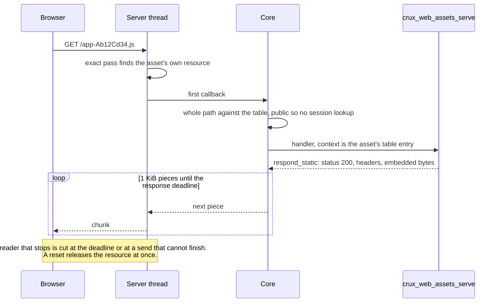

# Packaged web assets

Status: for review under [Issue #189](https://github.com/wonny-labs/crux-pilot/issues/189), in a Draft PR. Host and
`native_sim` evidence only, and the `native_sim` run is plain HTTP on loopback. **Nothing here ran on a board, and no
asset was served over TLS by this work.** Every timing below is an emulated container's figure on a loaded machine, and says
nothing about a target.

A product builds its frontend with any tool, names the built folder in its firmware composition, and serves it. The firmware
build needs no Node.js. This follows decisions W12, W13 and W16 of the
[web frontend design](plans/web-frontend-foundation-design.md): one registered resource per asset, a product-owned
interface, and firmware-embedded assets only.

## What exists

| Part | State | Evidence |
| --- | --- | --- |
| Packager, `components/web/tools/web_assets.py`: compress, hash, check, generate | Built | Python tests, run on a real Preact build |
| `crux_web_assets()` in `cmake/CruxWebAssets.cmake`, and its hand-off to `crux_web_routes()` | Built | Python tests with CMake, Host and `native_sim` builds |
| Handler and private asset table, `components/web/assets/` | Built | Host, `native_sim` |
| One public `GET` route per asset, `/` as a second route to `index.html` | Built | Host, `native_sim` |
| Reviewed-list entry `public GET @assets` for the generated routes | Built | Python tests, both builds |
| Budget: files, compressed total, largest asset from the response deadline | Built | Python tests, CMake build failure |
| Secret and device data check, with an optional deny list | Built, **pattern-based** | Python tests |
| Hash list for the SBOM | Built | Python tests, compared with the bytes the server sent on `native_sim` |
| Content policy setting, strict or inline styles | Built | Host, both values |
| Serving over TLS | **Not run by this work.** Same adapter as #185's image, which runs its suite over TLS. | |
| Asset size and speed on RT1060 | **Not measured.** The declared client rate is a decision. | |
| Safari, Chrome, Firefox loading a packaged folder | **Not run** | |
| Angular example folder | **Not packaged.** Its size is from the [implementation design](plans/web-frontend-implementation.md#packaging-budget). | |
| CI running the `native_sim` image | **Added** as one step in `zephyr.yml`, shard `io`, beside `scripts/test-web.sh native`. A change under `.github/` is listed in the PR for the owner's approval. | Not yet seen to run on CI |

## Acceptance criteria of #189

| # | Criterion | State | Evidence |
| --- | --- | --- | --- |
| 1 | Tests cover headers, encoding, the budget, a client disconnecting mid-asset and a missing folder | Met | Headers: `Web.assets_*` and the driver. Encoding: gunzip equals the file, in Python, and the server's bytes equal the listed hash. Budget: Python and a failing CMake build. Disconnect: `Web.assets_*` for the release of the resource, and the `native_sim` driver for a reset while the server is blocked in a send of a large asset. Missing folder: CMake configure fails. |
| 2 | A project serves its own folder by pointing to it, with no firmware logic change | Met | `tests/native/web_assets/src/main.c` holds no asset code. The folder and the policy are named in `CMakeLists.txt`, and the list of reviewed routes gains one line. |
| 3 | No public header or application contract exposes the asset table or its form | Met | The table and its header are in `components/web/assets/`, which no usage target includes. A test reads `include/` for the word, and checks the build files of the component. |
| 4 | A build with no web interface includes none of this | Met | Nothing in `components/web/CMakeLists.txt`, the Zephyr port or `zephyr/CMakeLists.txt` names it. The function adds its sources to the calling target only, and a test checks a build that does not call it. A web image with no `crux_web_assets` call holds none of it either. |
| 5 | The asset size and `CONFIG_CRUX_WEB_RESPONSE_DEADLINE_MS` are set together, and the budget states the largest asset that fits | Met | [Budget](#budget-and-the-response-deadline). The rate is a declared decision. |

## How it fits together

```mermaid
flowchart LR
    subgraph product["Product"]
        tool["Any frontend tool"] --> folder["Built folder<br/>index.html at its top"]
        cmake["CMakeLists.txt<br/>crux_web_assets(app FOLDER ...)"]
    end
    subgraph build["Firmware build, no Node.js"]
        packager["web_assets.py<br/>checks, gzip, SHA-256, budget"]
        source["crux_web_assets.c<br/>data, private table,<br/>one CRUX_WEB_ROUTE each"]
        list["crux-web-assets.json<br/>hash list, SBOM input"]
        routes["web_routes.py<br/>route table, one resource each,<br/>review list check"]
    end
    subgraph image["Firmware image"]
        resources["Registered resources<br/>/ , /index.html, /app.js ..."]
        handler["crux_web_assets_serve<br/>public GET"]
        adapter["Adapter<br/>pieces, deadline"]
    end
    folder --> packager
    cmake --> packager
    packager -- "fails the build on a budget,<br/>a secret, an unusable name" --> source
    packager --> list
    source --> routes
    routes --> resources
    resources --> handler
    handler -- "respond_static, headers per asset" --> adapter
    adapter --> browser["Browser<br/>hash routing, no deep link"]
```



A request for an asset runs through the same core as an API route. The whole path is compared with the route table first, so
`/index.html/x` gets the core's JSON `404`, and a path with no resource gets the server's plain `404`. There is no fallback
to `index.html`, because the interface uses hash routing.



## What a project writes

```cmake
crux_web_assets(app FOLDER ${CMAKE_SOURCE_DIR}/web/dist)      # strict content policy, the default
crux_web_routes(app SOURCES src/routes.c ZEPHYR_RESOURCES REVIEWED reviewed-routes.txt)
```

```text
# reviewed-routes.txt: one line covers every route of the packaged folder
public GET @assets
```

| Argument | Meaning | Default |
| --- | --- | --- |
| `FOLDER` | The built folder. A missing folder, or one with no `index.html`, **fails to configure**. | Required |
| `STYLE` | `strict`, or `inline` for a framework that injects styles at run time. No other value, and no policy string. | `strict` |
| `RESPONSE_DEADLINE_MS` | Sizes the largest asset. In a Zephyr image it is `CONFIG_CRUX_WEB_RESPONSE_DEADLINE_MS`, and **a different value here fails to configure**, so the budget is always sized for the deadline the image runs. | The Kconfig value, required elsewhere |
| `CLIENT_RATE` | Slowest honest client, in bytes a second, that the deadline is sized for | 32,768 |
| `MAX_FILES`, `MAX_TOTAL_BYTES` | The budget | 32 files, 393,216 compressed bytes |
| `DENY_STRINGS` | A file of strings, one per line, that may not appear in any file | None |

It must come before `crux_web_routes()` for the same target, and says so when it does not. After the build,
`<build>/crux_web_assets/<target>/crux-web-assets.json` is the hash list, and building the target
`crux_web_assets_<target>` alone packages and checks the folder. The two properties `CRUX_WEB_ASSETS_SOURCE` and
`CRUX_WEB_ASSETS_HASH_LIST` of the target name the files.

## Checks of the folder

All of them are reported in one run, and a failed run writes nothing.

| Check | Why | Refused |
| --- | --- | --- |
| `index.html` at the top | `/` serves it | A folder with only a nested one |
| A path of letters, digits and `.` `_` `~` `-`, at most 128 bytes | The server compares a path without decoding it, and its URL buffer is 255 bytes | A space, `%`, `;`, `@`, non-ASCII, a long path |
| No hidden file or folder | A built folder needs none: `.DS_Store`, `.git`, `.env` | Any segment starting with `.` |
| A known type only | Each asset needs a `Content-Type`, and none is guessed | `.map`, `.pem`, `.crt`, `.env`, `.md`, `.wasm`, no extension |
| No symbolic link | It could reach outside the folder | A link to a file or folder |
| A folder that can be read | An unreadable subfolder would be left out without a word | A folder the build cannot open, reported with its path |
| Nothing at `/api` or under it | An exact resource there would answer, with a plain `405`, in front of an API route with a path parameter | `api/v1/users/admin.json` |
| No empty file | A zero-length array is not C, and an empty script is a mistake | An empty file |
| No two paths differing only in case | The two server stacks compare differently | `Readme.txt` and `README.txt` |
| Secret and device data patterns | The bundle is public | Below |
| Deny list | A product's own list: a serial number, a test password | A listed string in any file, text or binary |
| File count, compressed total, largest asset | [Budget](#budget-and-the-response-deadline) | |

The served types are `html`, `js`, `mjs`, `css`, `json`, `webmanifest`, `txt`, `svg`, `png`, `jpg`, `jpeg`, `gif`, `webp`,
`avif`, `ico`, `woff` and `woff2`. WebAssembly is left out, because running it needs `'wasm-unsafe-eval'` in the script policy,
which stays `'self'`.

| Pattern, in text files | Label in the message |
| --- | --- |
| `-----BEGIN ... PRIVATE KEY-----` | a PEM private key |
| `-----BEGIN CERTIFICATE-----` and any other `-----BEGIN` block | a PEM certificate, a PEM block |
| `AKIA` and 16 capitals or digits | a cloud access key |
| `ghp_`, `gho_`, `ghu_`, `ghs_`, `ghr_`, `github_pat_` | a code host token |
| `xoxb-`, `xoxa-`, `xoxp-`, `xoxr-`, `xoxs-` | a chat token |
| `eyJ...` `.` `eyJ...` `.` signature | a signed token |
| Six hex pairs joined by `:` or `-` | a hardware address |

**This check finds shapes, not secrets.** It cannot see a password in prose, a serial number, a key in another form, or a
certificate that a product embeds by choice. The deny list is where a product states what is device data for it. The message names the
file and the label and never repeats the match. The ordinary words `password`, `token` and `secret` pass, because a login screen holds them.

## What each asset carries

| Header | Value | Why |
| --- | --- | --- |
| `Content-Type` | From the extension, `charset=utf-8` for text | No sniffing |
| `Content-Encoding` | `gzip`, only when gzip made the file smaller | An image of noise is stored as it is |
| `Cache-Control` | `max-age=31536000, immutable` when the file name holds a content hash, otherwise `no-cache` | See below |
| `Content-Security-Policy` | One of two fixed values, below | W12 and the Angular finding |
| `X-Content-Type-Options` | `nosniff` | |
| `Referrer-Policy` | `no-referrer` | The same as the core's own responses |

That is five or six headers. The server adds `Transfer-Encoding: chunked`, and its cap is 11. Each asset has its own header list in read-only data, so no
shared buffer holds one between pieces.

| Policy | `STYLE` | Value |
| --- | --- | --- |
| Strict | `strict` | `default-src 'self'; script-src 'self'; style-src 'self'; base-uri 'self'; form-action 'self'; frame-ancestors 'none'` |
| Inline styles allowed | `inline` | The same with `style-src 'self' 'unsafe-inline'` |

Scripts stay `'self'` and `frame-ancestors 'none'` stays in both. The packager has no way to take a policy: its
`--style` takes two values, and the text is in one private header. Two tests hold the exact text: the Host C suite compares the header
that each asset is served with to a literal string, for both values, and the Python policy test compares the header's two definitions to the same literals, so a `data:` or `blob:` source added to any directive fails both. Choosing `inline` weakens only style injection, which can still restyle a page to mislead a user, and
a project should record that choice. The core's own JSON responses keep their policy, `default-src 'self'; frame-ancestors 'none'`.

**Cache.** The server has no conditional requests, so `no-cache` costs a full download on every load, and it is the safe side for a file whose name does not
change when its content does. A name counts as fingerprinted when its last `-` or `.` part, before the extension, is 8 to 32 letters, digits or underscores and holds a capital or a digit:
`app.ZB34W522.js` and `index-DiwrgTda.js` do, and `bootstrap.min.js`, `main-bundle.js` and `my-long-name.js` do not. A hash that itself holds a hyphen
is read short and stays `no-cache`, which is safe. The list below shows each asset's class, and a frontend that does not fingerprint its files only
loses the cache.

## Routes and review

| Route | Method | Access | Resource |
| --- | --- | --- | --- |
| `/` | `GET` | Public | One, for the same data as `/index.html` |
| Each file's path | `GET` | Public | One each, fixed path, no wildcard |
| Anything else | | | The server's plain `404`, or its plain `405` for another method |

Assets are public because a browser must load them before login, which extends `CRUX_WEB_PUBLIC` to the whole bundle as the
[frontend design](plans/web-frontend-foundation-design.md) says. A person reviews public routes through the reviewed list, and
a build changes the set of assets each time the frontend does, so the list holds one entry, `public GET @assets`, and the
review of content is the packager's checks and its hash list. These rules keep that entry from covering more, and the last one says what they cannot:

- `crux_web_routes()` reads a bundle only from the source that `crux_web_assets()` set and marked with a private property, and stops the configure when the source property is set any other way.
  That guard is for mistakes, and a project that sets both properties by hand is not stopped by it.
- `web_routes.py` accepts a source as a bundle only if it is **byte for byte what the packager writes**. This is an equality, not a pattern. `components/web/tools/web_assets_form.py`
  holds the one form, and both tools use it: `web_assets.py` writes the source with `render_source()`, and `web_routes.py` reads the content policy choice, each asset's path and
  its embedded bytes out of the file, renders the source again from those, and refuses the file unless it equals the result. So every other line, the two preprocessor lines, the header lists, the table, the count, each route and its handler `crux_web_assets_serve`, is
  derived and never read. A different line end, a trailing space or tail, an extra or missing blank line, a directive, a comma declarator or any other statement is a difference, and so is a route that does not match its asset.
  What can differ from a given output is the data bytes, which are inert, the 0 or 1 of the style choice, which the scan cannot check against the CMake call, and **the set of assets itself**: a hand-made bundle
  chooses its asset paths and how many there are, within the path characters, as public `GET` routes outside `/api` with an `/index.html`, and the review line `public GET @assets` does not say which. The packager's folder checks do not apply to it,
  so what such a bundle serves is reviewed in the project that makes it.
  The bundle file is read without newline translation, so a CR is a difference too. The route macro reader of the next rule still runs on the accepted text.
- Each route must also be a public `GET` of a fixed path outside `/api`, in the plain `CRUX_WEB_ROUTE` form, named `crux_web_asset_route_*`, with the handler `crux_web_assets_serve` and exactly an element of
  `crux_web_asset_table` as its context. So a bundle can serve bytes at a public path, and cannot run another handler.
- **What no scan sees.** The tool reads one source file, and it has no way to see how the compiler is run. Compile definitions (`-D`), include paths that put another `web_assets_internal.h` first, and a project that sets both private properties by hand are
  outside any scan, and deliberate misuse of them is caught only by reviewing the project's CMake composition. The reviewed entry means that the bundle came through `crux_web_assets()`, not that a hostile build was stopped.
- The entry is required when the bundle exists, and refused as stale when it does not.
- Session-only and permission routes of the same image are listed and reviewed one by one, as before.

## Budget and the response deadline

The server sends one response on its single thread, in 1 KiB pieces, and it checks `CONFIG_CRUX_WEB_RESPONSE_DEADLINE_MS` only
between pieces. While it runs, no other client is served. A large asset can therefore cut a slow but honest client, and a
slow client can hold the thread until the deadline. So the largest asset is sized from the deadline and a declared rate:

**largest asset, in compressed bytes = declared client rate x response deadline**

| Deadline | At 32,768 bytes a second (the default) | At 16,384 |
| --- | --- | --- |
| 1,500 ms (the `native_sim` images) | 49,152 | 24,576 |
| 3,000 ms (the default) | **98,304** | 49,152 |
| 5,000 ms | 163,840 | 81,920 |
| 10,000 ms | 327,680 | 163,840 |

The packager prints this, and an asset over it fails the build and names the asset, its size and both numbers. The number is bytes served, which for a gzip asset
is the compressed size. The default budget is 32 files and 393,216 compressed bytes in all.

**RAM.** The data stays in Flash. Each asset is a registered resource whose detail struct is writable, because the server records the client that holds it there, which is
about 1 to 2 KB for 32 files. This is an estimate from the struct, **not measured**, and the route table and resource descriptors are read-only data on top of it.

| Value | Where it comes from |
| --- | --- |
| Declared client rate, 32,768 B/s, 256 kbit/s | **A decision, not a measurement.** [#184](web-contract.md#bounds-and-measurements) measured a reader draining 20 KB/s being cut by the deadline, and no document measures an honest client. 32 KiB a second is a poor but working link, and a real browser on a local network is far faster. |
| Deadline, 3,000 ms | #184's default, unchanged. The `native_sim` images use 1,500. |
| 32 files | Browsers open several connections and the server has three clients. The Preact example has 4 files and the Angular example 5. |
| 393,216 bytes | Room for the Angular example, 97,941 compressed bytes by `tools/compare.ts` with all six screens, four times over. It is a budget for Flash use, not a server limit. RT1060 Flash use is not measured. |
| Preact example, built here | 4 files, 20,314 bytes served, the largest asset 18,599: **fits with 5 times to spare**. At the default rate its script takes 0.57 s. |
| Angular example | 97,941 compressed bytes in 5 files with network settings and restart (`tools/compare.ts`; `web_assets.py` counts 97,899 served). The largest file, the script, is 92,011, under 98,304, so it fits the defaults with 6,293 bytes to spare. Not packaged here. |

What a slow client costs the others, by the sums in the [web contract](web-contract.md#the-slow-reader-bound) and not measured at the default settings: the deadline, 3 s,
plus the sends of the callback in flight. A response has 5 or 6 headers, which is 24 sends in its first callback, at 250 ms each: up to 6 s, and later pieces take 4 sends, up to 1 s. That is
about 7 s in the worst case, under the 10 s inactivity timer, so another client waits and is not closed. Over TLS a response also stops at
the first send that cannot finish within the send timeout, so a slow client is cut sooner than on plain text:
[HTTPS composition](https-composition.md#negative-handshakes). Raising the deadline raises this stall by the same amount, and the largest asset with it.

## Measured on `native_sim`

Plain HTTP on loopback, the native socket offload, an emulated container on a loaded machine, and the shortened settings of
`tests/native/web_assets/prj.conf`: response deadline 1,500 ms, send timeout 500 ms, inactivity 3 s. The folder has six files, and the largest asset is
a 46,152-byte font of noise, which does not compress. The driver's bound for another client is the deadline plus 24 sends at the send timeout plus 1.5 s of slack, 15 s.

| Measurement | Result | Bound |
| --- | --- | --- |
| Each of six assets, one request | 4 to 14 ms. The 46 KB font took 14 ms. | None. Too small to test the stall bound. |
| Three clients, four rounds of every asset, in parallel | All 72 responses correct, **no `409`**, in 0.22 s | A `GET` completes in one server pass, so one resource per asset does not make two browsers collide |
| Every response against the hash list | The embedded bytes' SHA-256, and the gunzipped file's SHA-256, match the list for all six | |
| Reset after 1,866 bytes of the font, server blocked in a send | Another client waited 0.404 s behind the blocked server, and was served 5 ms after the reset. The font then came whole, twice. | The resource is free at once, by the server's release of a registered resource |
| A reader that stops, small send buffer, 46,152-byte font | Another client waited 1.898 s, then was served. The response was **cut after 10,633 bytes** and the connection closed. The font then came whole. | At most 15 s, and here the deadline of 1.5 s plus a send. **This is the cut of a slow client that the issue names.** |

The cut is the same path that #184 measured with a body of 8 MB. What is new here is that an asset of the size the budget allows reaches it, and only for a reader that stops or goes slower
than its buffers.

## The hash list, for the SBOM

`crux-web-assets.json` holds, for each asset in path order, its path and file, type, encoding, cache class, size and SHA-256 of the file, and the size and SHA-256 of the bytes embedded. It
holds no file content and no timestamp, so the same folder gives the same list, which a test checks, and
the same gzip bytes with one Python and zlib. The list also records the style, the budget and the totals. The CycloneDX record of production packages comes from `npm run sbom`, and a
product joins the two. The embedded bytes are in the signed firmware image, so the list also lets an image be checked against its folder.

## Decisions for review

| # | Decision | Why | If changed |
| --- | --- | --- | --- |
| 1 | The setting is `crux_web_assets(... STYLE strict\|inline)` in the composition's CMake, not a Kconfig symbol | The composition names the folder there, and no shared Kconfig file changes | A Kconfig choice that the function reads |
| 2 | Declared client rate 32,768 B/s, so the largest asset is 98,304 B at 3 s | Nothing measures an honest client | Measure on RT1060 in #197 and set the rate |
| 3 | Defaults of 32 files and 393,216 bytes | See above | Per product, by argument |
| 4 | gzip at level 9, and only when it is smaller | Every current browser reads it, the Preact example is measured the same way, and no library is needed. Brotli would save more but needs a package. | Add `br` as a second encoding, which needs `Accept-Encoding` captured |
| 5 | Assets are always sent encoded, whatever the client's `Accept-Encoding` | The server captures seven headers, and none of them is that one. A client that cannot read gzip, such as `curl` without `--compressed`, gets bytes it must decode. | Capture the header, and store both forms |
| 6 | Public routes of the bundle are one reviewed entry, `public GET @assets` | The set changes with every frontend build | One entry for each asset |
| 7 | Cache by file name: a fingerprint is immutable for a year, everything else `no-cache` | No revalidation exists on the server | An option to name which files are immutable |
| 8 | A fixed list of served types, with `.map` and `.wasm` refused | A source map exposes source, and WebAssembly needs a weaker script policy | Add a type with its own review |
| 9 | The secret check is a short list of shapes plus a deny list | A broader pattern, such as `password =`, would fail ordinary login screens | Product patterns in the deny list |
| 10 | The packager errors on a hidden file, an empty file, a symbolic link, an unreadable folder and a path under `/api` rather than skipping them | A silent skip hides what a build does not ship, and an exact resource under `/api` would answer in front of an API route | A skip list |
| 15 | A file that is already gzip, whatever its name, is served as it is with `Content-Encoding: gzip`, after it decodes cleanly as **one member with nothing after it** (up to and including 16 MiB, one byte more is refused) and its content is scanned. A second member or a trailing byte is an error, because a client decodes every member and the scan reads one. | Packing it again would double the size and break the file | Refuse them |
| 16 | In a Zephyr image `CONFIG_CRUX_WEB_RESPONSE_DEADLINE_MS` wins, and a different `RESPONSE_DEADLINE_MS` is an error | The budget must be sized for the deadline that runs | Warn and use the Kconfig value |
| 11 | No `ETag`, no `HEAD`, no range requests | The server answers a conditional request in full and `HEAD` with `405`, and the adapter's capture has no room | Later, with the capture |
| 12 | `base-uri 'self'` and `form-action 'self'` are in both policies | Angular's index has a base element, and a form may post to the API | Tighter when no framework needs them |
| 13 | A new check script and a new test runner, `scripts/test-web-assets.sh`, and `scripts/test-web.sh` is not touched | #281 edits that runner, so this avoids a conflict | Join the two |
| 14 | The generated source defines `CRUX_ASSETS_INLINE_STYLES`, not a `CRUX_WEB_` name | The route scan refuses a `#define` of a `CRUX_WEB_` name in a source of routes | |

## Limits and what was not tested

| Item | State |
| --- | --- |
| A response over TLS | Not run by this work. The adapter is the one #185 runs over TLS, and the `native_sim` image here uses plain HTTP. |
| A slow reader and a reset mid-asset, on `native_sim` | Run with the send buffer of one connection shrunk by a probe route of the test image, as on a small target, because loopback buffers otherwise take the whole asset and the server is never part-way. [Measured](#measured-on-native_sim). The probe is test code that depends on a private driver struct, as #184 declares. |
| RT1060 Flash, RAM and load time | Not measured. No board was used. |
| Real browsers | Not run against a packaged folder, so neither policy value was checked in one, and no page load was timed. |
| The Angular example | Not built or packaged here. |
| Brotli, `HEAD`, ranges, conditional requests | Not provided |
| A frontend that needs `'unsafe-eval'`, a nonce or an external origin | Cannot be served. That is the design. |
| Two files with one name that differ only in case, on a case-folding file system | Not testable on macOS, so the test skips there and runs on Linux |

## Tests

| Command | Level | Covers |
| --- | --- | --- |
| `python3 -m unittest tests/build/test_web_assets.py` | Python, with CMake | Packager: encoding, hashes, headers, policy, routes, review list, budget, folder and name checks, secrets, boundaries, the CMake function |
| `scripts/test-web-assets.sh host` | Host | The above, `Web.assets_strict` and `Web.assets_inline` under the debug and sanitizer presets, clang-tidy, route review and boundary checks |
| `scripts/test-web-assets.sh native` | `native_sim` | `tests/native/web_assets`: the real server, the real adapter, a packaged folder, and the driver. In `zephyr.yml`, shard `io`. |
| `scripts/test-web.sh host` | Host | Unchanged. The `Web.assets_*` suites and the Python tests are registered in the full Host build and in `unittest discover tests/build`, so the PR's CI runs them. The sanitizer preset ran only in CI, since the local image lacks the clang runtime. |

The Host suites use a fake transport that sends a response whole, so a client going away mid-asset there shows that nothing
stays held. The `native_sim` driver resets a connection while the server is part-way through a large asset.
