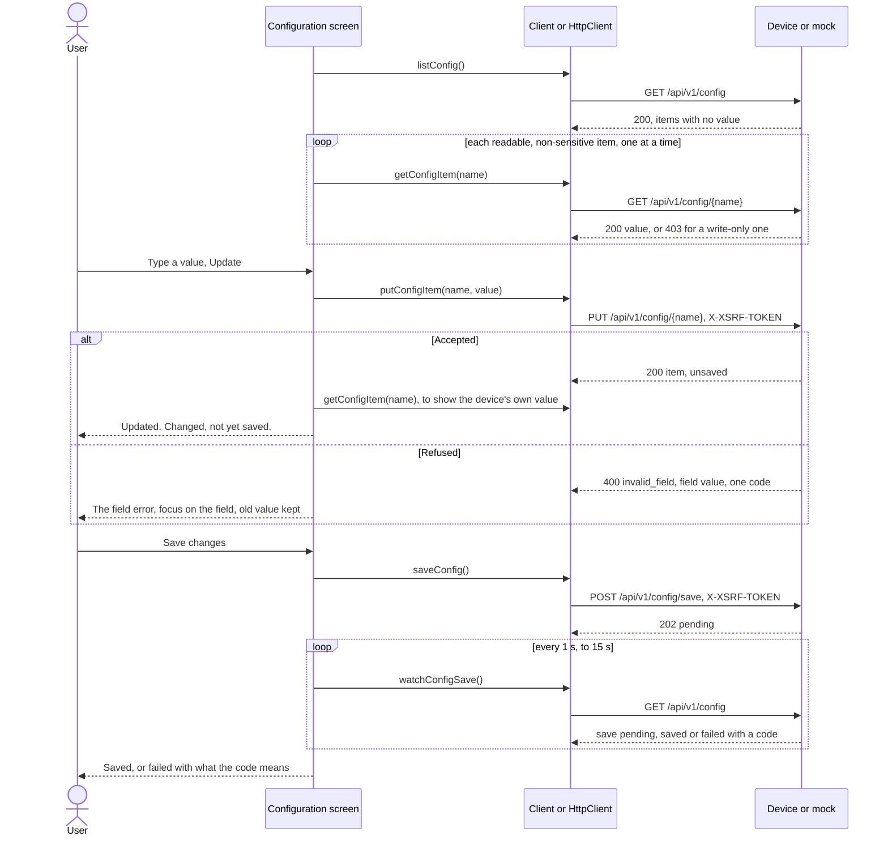
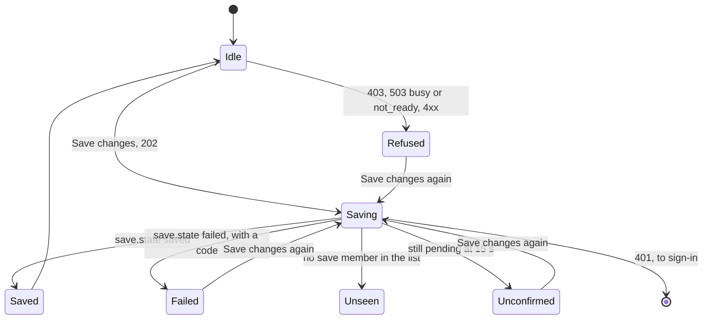

# Web examples: the core configuration flow

Status: implementation for review under Issue #243. It shows the core configuration flow end to end on the **mock server only**,
in both web examples. Nothing here ran on a device, over TLS or on `native_sim`, which is #220, and nothing was run on a
board. Mock results are mock evidence and stand in for none of those.

Crux provides the services, the APIs and HTTPS hosting, and the product owns its application UI. The Preact example in
`web/reference` and the Angular example in `samples/web/angular-minimal` are examples, with no promise of feature parity and no
component library. The API is the one in [`web/api/openapi.yaml`](../web/api/openapi.yaml), described on the firmware side in
[status, configuration and account web APIs](web-management-apis.md). Design background:
[web frontend foundation](plans/web-frontend-foundation-design.md) (W13 and W15) and the
[web frontend implementation](plans/web-frontend-implementation.md).

## What is built, faked and untested

| State | Item |
| --- | --- |
| Built | `web/client`: `listConfig`, `getConfigItem`, `putConfigItem`, `saveConfig` and `watchConfigSave`, and `parseConfigInput` for the text of a field |
| Built | Preact example: a configuration screen at `#/config`, in the navigation |
| Built | Angular example: the same screen, the forced password change screen, and a navigation. A route guard keeps a session that must change its password on that screen. |
| Built | Shared browser cases in `web/e2e/shared-cases.ts`, run on both examples: 12 for the forced change and 26 for configuration |
| Built | Preact-only configuration cases in `web/e2e/reference-config.test.ts`: 6 |
| Faked | The device. The mock keeps the parameters and the state of a save, over plain HTTP on the loopback address, and holds one session at a time |
| Untested | TLS, real sessions, the device's single server thread, the save's time on a target, and the device's answers while the worker is inside storage (the mock forces them) |
| Untested | Firefox, Edge and Safari. The cases ran on Chromium only. |
| Untested | A screen reader. Accessibility is checked through roles, labels, focus and the keyboard, and `tools/check-dom.ts` |
| Not changed | The specification, the mock server, the C-build boundary rule, `.github/` and every other protected path |

## The flow

`busy` and `not_ready` on the list during a save mean that the worker is still inside storage, and the wait goes on after the
longer of one second and the device's `Retry-After`.

## What each answer shows

| Answer | On an update | On a save |
| --- | --- | --- |
| `200` | The item replaces the row's flags, the value is read back, and a status notice names the parameter | Not applicable. `202` starts the wait. |
| `400` `invalid_field`, field `value` | `out_of_range`, `rule_not_met` and `wrong_type` each have a message under the field, tied with `aria-describedby`, and focus goes to the field. The old value stays. | Not applicable |
| `400` `bad_request` or `413` | The device's own text for that code | Same |
| `401` | The session is lost: sign-in takes over with the notice that the session has ended | Same |
| `403` | "This account may not change the parameter" | "This account may not save changes" |
| `404` | "The device has no such parameter", and the list is read again | Not applicable |
| `409` | Retried by the client, 300, 600 and 1200 ms, and then busy | Same |
| `503` `busy` with `Retry-After` | "The device is busy. Try again in N seconds." The typed value stays. The Preact client first retries one wait of 5 s or less. | Same, and the button works again |
| `503` `not_ready` | "A service on the device is not ready." | Same |
| No answer | "The device did not answer" | Same, and a failed poll during the wait is tried again |

| Save result in `save` | What the person reads |
| --- | --- |
| `saved` | The changes are saved, and the unsaved marks clear from the list that said so |
| `failed`, `storage_failed` | The device could not store the changes, saves made earlier stay saved, try again |
| `failed`, `not_supported` | No Configuration provider, the changes stay in memory until the next restart, retrying will not help |
| `failed`, `not_ready`, `busy`, `unauthorized`, `permission_denied` | One sentence each. No code names a parameter, because a save also writes parameters this session cannot see. |
| No `save` member | The device accepted the save, and this account cannot see its result |
| Pending at the limit | Accepted but not confirmed in time, and the list is read again |

## What a parameter shows

| Item flags | Value | Control |
| --- | --- | --- |
| `readable`, `writable` | Read with `GET`, shown as text | A field or a switch, and Update |
| `writable`, not `readable` | "The value is not shown to this account." No `GET` is sent. | A field or a switch, and Update |
| `sensitive` | "A sensitive value is never shown." No `GET` is ever sent. | None. See decision 2. |
| `readable`, not `writable` | Read with `GET` | None, and "Read only for this account." |
| `unsaved` | "Changed, not yet saved" | |

The device decides what the session sees, so the screen hides nothing itself. A session that sees nothing gets "nothing to configure"
and no error. The Save button shows when any listed parameter is writable. The list shows `save` only to a session holding
`config.save`, so the screen cannot tell beforehand, and a session without it learns from the `403`.

The value of a text parameter is shown as text and never as markup, and a value read after the person started typing does not
replace what was typed.

## The client calls

| Call | Request | Result |
| --- | --- | --- |
| `listConfig()` | `GET /api/v1/config` | The items, and `save` for a session that holds `config.save` |
| `getConfigItem(name)` | `GET /api/v1/config/{name}` | The name and value |
| `putConfigItem(name, value)` | `PUT /api/v1/config/{name}`, one `value` member in the JSON type of the parameter, with `X-XSRF-TOKEN` | The item, which holds no value |
| `saveConfig()` | `POST /api/v1/config/save`, no body, with `X-XSRF-TOKEN` | `pending` |
| `watchConfigSave()` | `GET /api/v1/config` until `save` ends | `saved`, `failed` with a code, `not_visible`, `not_confirmed`, `aborted` or `failed_request` |
| `parseConfigInput(type, text)` | None | A number or a string, or `empty`, `not_integer` or `not_text`. It holds no range rule. |

A name outside `A-Z a-z 0-9 _ - .` of 1 to 30 characters, and `.`, `..` and `save`, is refused before any request, because
`save` is a fixed route and the others cannot be keys. The Angular example does not import the client at run time. It uses
`HttpClient` with the generated types and keeps its own, smaller code for the same rules.

## The two examples

| Aspect | Preact example | Angular example |
| --- | --- | --- |
| Route | `#/config`, with a link named Configuration | `#/config`, with the same link |
| Forced password change | In the shell, whatever the route | The `/change-password` route, and guards that send a session that must change there, and any other away |
| Navigation while a change is forced | None | None |
| Calls | The framework-free client | `HttpClient`, which sends `X-XSRF-TOKEN` itself on a same-origin `PUT` or `POST` |
| Retry of `409` | Client | Own loop in `api.ts` |
| Retry of a short `503 busy` | Once, by the client | None. The wait is shown. |
| After sign-in following an expired session | Returns to the route in the address | Returns to home |
| Text | One table, `text.ts` | Constants in each component |

## Evidence

Cases are written by role, label and visible text, so one list holds for both examples. Both run against the mock, and every
mock answer is checked against the specification.

| Acceptance criterion of #243 | Shown by |
| --- | --- |
| A shared case reads a value, updates it, shows a field error for an invalid value, and shows a denied update | `configuration lists each parameter…`, `an update sends the token…`, `a value the device refuses…`, `an update that the device refuses as not permitted…`, `a session that may write and not read…` |
| On Angular, the forced password change cases pass, and a protected API cannot be used before the change is made | The 12 forced-change cases, among them `a protected route cannot be used before the change is made` and `a forced change holds the session…` |
| Session expiry during a configuration update returns to sign-in on both | `a session that expires during an update…` and `…during a save…`, and `an expired session during a forced change…` |
| The Preact example stays within its budget, or the change is recorded. The Angular size is measured again. | [Sizes](#sizes) |
| Mock results are recorded as mock evidence only | This document, and the PR |

| Case group | Count, per example | Covers |
| --- | --- | --- |
| Forced password change | 12 | Held on the screen whatever the route and asking for nothing protected, a protected route refused before the change, completion with the token and the poll header, wrong current password, refused new password, passwords that differ, failed save, a lost result either way, a session that ended, expiry, sign-out |
| Configuration, update | 14 | Listing, no sensitive value or read of it, an update with the token, a switch and a text value, the three field codes, text that is no whole number, a read-only session, a write-only session, `403`, `404`, `409`, busy with its wait, not ready, a value read after typing |
| Configuration, save | 6 | Pending then saved, failed, no provider, busy, not ready, busy while the worker saves |
| Configuration, sessions and the list | 6 | The list failing with a way to try again, expiry during an update and during a save, no session, an empty list, nothing in browser storage |

The mock accounts decide who sees what: `operator` holds everything, `viewer` may read, `writer` may write and not read or
save, `guest` sees nothing and `newuser` must change its password.

## Sizes

| Build | Files | Bytes | Compressed bytes | Limit |
| --- | --- | --- | --- | --- |
| Preact example, all six screens, before #243 | 4 | 59061 | 20455 | 32768 |
| Preact example, all six screens | 4 | 68922 | 23144 | 32768 |
| Preact example, core screens | 4 | 58559 | 20715 | |
| Angular example, before #243, sign-in and home | 5 | 249403 | 76710 | 300 kB raw initial, error |
| Angular example, core screens | 5 | 292950 | 88961 | 300 kB raw initial: 275.28 kB used |

The Preact budget in `web/reference/budget.json` is unchanged, with 9,624 bytes left. The Angular example uses 275.28 kB of its
300 kB raw limit for the initial bundle, so a further screen needs a decision about that limit. The rows before #243 were measured on the base commit, and the Preact one differs from the earlier record of 20406 compressed bytes in
`web-frontend-implementation.md`, which is older than it. `node tools/compare.ts` gives the table, and the two-screens fixture now holds home and configuration so that
it matches the Angular example's core flows.

## Differences from the device that this work relies on

| Item | Mock | Device |
| --- | --- | --- |
| The list during a save | Never busy. A test forces `busy` to show the wait. | `503 busy` while the worker is inside storage |
| Body limit of an update | 4,096 bytes | 1,024 bytes |
| Connection after an update | Kept | Closed after every update, so each costs a new TLS handshake |
| Number reading | A pattern on the one `value` member | A bounded reader. The two differ on an escaped member name, which no browser sends. |
| Save time | The configured number of reads of the list | Unknown until a target runs it |
| Sessions | One at a time, no idle timer | Real limits |

## Decisions for review

Each was taken for lack of an answer, as the narrower choice.

| # | Decision | Reason | Alternative |
| --- | --- | --- | --- |
| 1 | The screen lists every parameter that the session may see, and does not name one parameter | The issue says "a simple configuration update", and a device's table is its own. A screen with one fixed name would not work on another device. | A screen for a named parameter set by the entry file |
| 2 | A sensitive parameter has no control, even when it is writable | A write-only secret needs a different screen: a masked field, no echo and no keeping the typed text. That is a security-sensitive design. | Add a masked write-only field |
| 3 | Save is shown whenever a parameter is writable, and a `403` says that the account may not save | The list shows `save` only after a save, so a session's `config.save` cannot be known beforehand | Hide it until a first save |
| 4 | Each value is read after its update, so the device's own value is shown | The update's answer holds no value, by design | Show what was typed |
| 5 | The values are read one at a time | The server has one thread that other clients share | In parallel |
| 6 | Text for a whole number that is not a safe integer, or has anything but digits and a minus, is refused before any request, and the range is left to the device | The device's answer is the validation that counts, and `out_of_range` then shows in the browser cases | Check the range in the browser |
| 7 | The Angular example does not import the client | The earlier comparison stands on a type-only import, and it shows how a product with its own stack does it | Reuse the client |
| 8 | The Angular example shows a short `503` and does not retry it | The sample keeps its code small. The wait is shown with its length, and a second click is safe, because the device did not process the request. | Copy the client's one retry |
| 9 | The two-screens fixture now holds home and configuration | CI builds it by that name for the comparison, `.github/` is protected, and the two builds should hold the same core flows | A new fixture and a change to the workflow |
| 10 | The Angular policy walk includes the configuration screen | The strict-policy count must cover a screen that has component styles. The strict count changed from 1 to 4, all style events. | Leave the walk as it was |
| 11 | The Angular size limit of 300 kB is kept | 24.7 kB are left. A change to it is the owner's call. | Raise it now |

## Results

Local runs in container `crux-243`, image `crux-pilot-devcontainer:local` under amd64 emulation, Node.js 24.22.2, Chromium 156
from Playwright 1.64.1 headless in that container. The container held the only install of the packages. CI results are in the pull
request.

| Check | Level | Result |
| --- | --- | --- |
| `client/test/config.test.ts` before the client had the calls | Node.js, red | 22 of 22 failed, with `is not a function` |
| `client/test/config.test.ts` and `config-input.test.ts` | Node.js | 27 of 27 pass |
| `configuration lists each…` and `an update sends…` on the Preact example before the screen existed | Browser, red | Both failed after 30 s, with the group not found. The forced change cases passed, because Preact already had that screen. |
| `forced change completes`, `wrong current password` and `configuration lists each…` on the Angular example before its screens existed | Browser, red | All three failed after 30 s |
| A test that typed before a value was read | Browser, red | Failed on the first run of the case `no value or password reaches browser storage…`, because the read replaced what was typed. The fix is `edited` on a row, and the case `a value read after the person started typing…` holds a read back until after the typing. |
| `npm run check` in `web`, and `check-dom` on the Angular source | Node.js | See the pull request |
| Shared cases on the Preact example, the Preact configuration cases, the shared cases on the Angular example, and the policy walks | Browser, mock | See the pull request |
| Full CI presets | GitHub Actions | See the pull request |

## What is not verified

- Any of this on a device, on `native_sim`, over TLS or on a board. #220 does the first two against real HTTPS.
- The device's `503` while a save runs, the save's time, and the single server thread's response to the values being read one
  at a time. The mock never does these.
- Concurrent clients, and another session's save showing in this session's list.
- Browsers other than Chromium, and any screen reader.
- The Angular example under the strict style setting, which still breaks on component styles as before.
