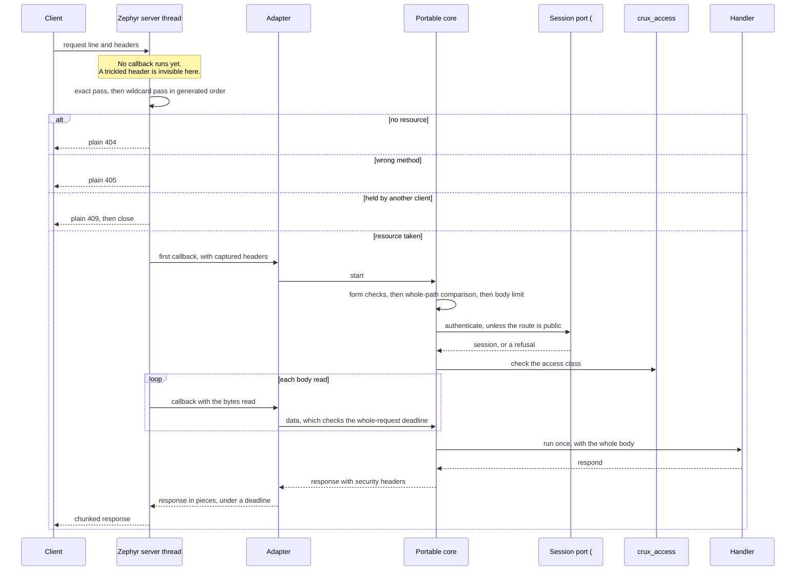

# Web contract and private HTTP adapter

Status: implementation for review under Issue #184. Nothing here has run on a board, and nothing here uses TLS, which
is #185 and the probe in #242.

Owner: `components/web`. Public header `<crux/web.h>`, usage target `crux::web`. Adapter header `crux_web_adapter.h`,
internal target `crux_web_adapter`.

## What exists

| Part | State | Evidence |
| --- | --- | --- |
| Public contract, access class compile rule | Built | Host, boundary check |
| Route generator and review list | Built | Python tests, Host, `native_sim` |
| Portable core: whole-path comparison, form checks, enforcement, body, deadline | Built | Host on the real Access core |
| Adapter over the Zephyr HTTP server | Built | `native_sim`, plain HTTP on loopback |
| Wildcard resources on RT1060 | Compile and link only | Mbed TLS and wolfSSL profiles, not run |
| Login, sessions, CSRF and `Origin` rules | **Built** in #186: see [web-session.md](web-session.md). This suite still uses stand-ins. | Host, and `native_sim` in `tests/native/web_session` |
| Access core on Zephyr | **Faked on `native_sim`** by a double, until #242. The real core and its fake ports run on Host | |
| Socket shutdown on `native_sim` | **Shimmed in the test image**, see [below](#three-limits-of-native_sim-found-here) | |
| A send that returns `-EAGAIN` on `native_sim` | **Injected in the test image** by a wrapped send, because the offload rarely produces one | |
| TLS handshake stall | **Not measured.** Read from source and declared, see [below](#tls-handshake-stall) | |
| Streaming upload contract | Not built. A probe in the test image measures it, and #188 chooses the contract | |
| Anything on a board | Not run. Hardware needs separate approval | |

## How a request flows



The order in the core is a rule, and tests hold it. The whole path is compared with the route table before access is
checked, so an unknown path says nothing about what a session may do, and costs no session lookup.

## Contract for a project

```c
#include <crux/web.h>

static crux_web_result_t on_pump_status(crux_web_request_t *request, crux_access_session_t session,
                                        void *context);

CRUX_WEB_ROUTE(pump_status, "/api/v1/app/pump", CRUX_WEB_GET, "app.pump.read", on_pump_status, NULL);
CRUX_WEB_ROUTE(pump_item, "/api/v1/app/pump/{id}", CRUX_WEB_GET, CRUX_WEB_SESSION, on_pump_item, NULL);
```

```cmake
crux_web_routes(app SOURCES src/pump_routes.c REVIEWED reviewed-routes.txt ZEPHYR_RESOURCES)
```

| Rule | How it holds |
| --- | --- |
| A route with no access class fails to compile | Six macro arguments, so leaving it out is a wrong count. The access argument is wrapped in empty string literals, so `NULL`, a number or a variable does not compile, and an empty string fails an assertion. |
| A route the macro did not make cannot run | Only the generated table reaches the core. A hand-made route with no access class is refused with `403`, shown by a test. |
| A route in a source not named to the build | Not in the table, so it is unreachable: fails closed. |
| A route the scan saw but the compiler did not, such as in `#if 0` | Fails to link. |
| A project sees no native header | `tests/web_consumer` builds as C17 and C++17 under `crux_assert_portable_consumer` and `crux_assert_access_consumer`, and `tests/native/web_http` builds its project route in a library with no Zephyr requirement. |
| Public and session-only routes get a review | `crux_web_routes(... REVIEWED list)` fails the build otherwise, in both directions, and sees generated sources and any layout. An image with Zephyr resources must give a list. `scripts/check-web-routes.py` lists them, and holds what is tracked outside `tests/` to `components/web/reviewed-routes.txt`. |

## Resources the build generates

| Finding at Zephyr v4.4.2 | What the generator does |
| --- | --- |
| A duplicate path answers `405` for the second method | One resource per path, with its methods merged |
| The exact pass runs first, then the wildcard pass takes the first match in section order | Numbered names, `crux_web_resource_0000`, which sort in the generated order |
| `FNM_LEADING_DIR` makes `/api/v1/session` match `/api/v1/session/attempt/x` | Every wildcard before every fixed path |
| A trailing `*` also matches deeper paths | Deeper before shallower, among wildcards and among fixed paths |
| Two wildcards of one depth could match one request, and then the holder is arbitrary | Refused at build time |

What the core takes from a request that reached it does not depend on which resource brought it there. `HEAD` and
`OPTIONS` are never in a resource's mask, because the server answers a masked `HEAD` with `200` and runs no callback.

## Responses from the server, declared

These are sent before any Crux code runs, and they hold no JSON and no security header. `tests/native/web_http` compares
the first three byte for byte.

| Response | When | Bytes |
| --- | --- | --- |
| Plain `404` | A path with no resource | `HTTP/1.1 404 Not Found`, `Content-Length: 9`, `Not Found` |
| Plain `405` | A method outside the resource's mask, including `HEAD` and `OPTIONS`, and a deeper path under a route without that method, such as `GET /api/v1/session/x` | `HTTP/1.1 405 Method Not Allowed`, `Content-Length: 18`, `Method Not Allowed` |
| Plain `409` | Another client holds the resource. The connection then closes. | `HTTP/1.1 409 Conflict`, and no body |
| Plain `500` | A malformed request, or a URL over 255 bytes | `Internal Server Error` |
| Plain `426` | A request with `Upgrade`. The server then runs the resource, so the adapter closes first and no handler runs. | `Wrong upgrade` |
| No answer | A request of under 24 bytes waits for more until the inactivity timer. A browser's request is always longer. | |

A deeper path under a route that has the method reaches the core and gets the JSON `404`: `/api/v1/status/x` does, as
the specification says. A value equal to a fixed neighbour is shadowed: `GET /api/v1/config/save` gets the plain `405`,
because the exact pass finds the fixed `POST` route first, so a configuration parameter cannot be named `save`.

## Answering early

The server finishes a response only when the request is complete, and it adds a plain `500` after a callback error unless
headers were sent. So a refusal before the body has ended is written by the adapter as a complete response with
`Connection: close`, then the adapter marks headers sent and returns an error. The same path answers `400`, `401`,
`403`, `404` and `413` with the JSON form and the security headers. A request with no body uses the server's own path
and keeps its connection. A client still sending when the socket closes may see a reset instead of the answer, which is the
usual result of closing with unread data.

| Request | Answer | Reason |
| --- | --- | --- |
| A header dropped by the capture, or a captured header sent twice | `400 bad_request`, closed | A dropped header is never read as having no session |
| `Transfer-Encoding: chunked` | `400 bad_request`, closed | The callback would get the raw chunk framing as body |
| A body on `GET` or `DELETE` | `400 bad_request`, closed | The server calls back once per read, which would run a handler twice |
| More or fewer bytes than `Content-Length` | `400 bad_request`, closed | The server passes its whole buffer, so these can be the next request's |
| `Content-Length` over the route's limit | `413 payload_too_large`, closed, before any session lookup | |
| Pipelined requests in one read | The server joins their URLs and headers, and routes the joined path | `GET /api/v1 ...` then `GET /status ...` in one send gets `/api/v1/status`. Access applies to the joined path, with the headers of both, so a `Cookie` in either counts and a `Host` in both is a duplicate. Shown on `native_sim`. No browser sends this. |
| A path parameter holding anything but unreserved characters, or `.` or `..` | JSON `404` | Nothing is decoded, so `%2F` and `%2e%2e` cannot become a path |
| A handler that returns with no response | `503 not_ready`, with `Retry-After` | The `ErrorCode` list has no code for it, and a new code is a change to the specification |

## Bounds and measurements

Evidence is `native_sim/native/64`, on the host's TCP stack through the native socket offload, in an emulated container
on a loaded machine, with plain HTTP. **None of this is device evidence**, and each result scales with the settings. The
test image uses shortened settings, in the first row. The revision and raw output are in the pull request.

| Setting | Test image | Default | Why |
| --- | --- | --- | --- |
| `HTTP_SERVER_CLIENT_INACTIVITY_TIMEOUT` | 3 s | 10 s | Upstream's |
| `CRUX_WEB_REQUEST_DEADLINE_MS` | 2,000 | 5,000 | Whole request, from first callback to last body byte |
| `CRUX_WEB_SEND_TIMEOUT_MS` | 500 | 250 | One socket send, not one response |
| `CRUX_WEB_RESPONSE_DEADLINE_MS` | 1,500 | 3,000 | One response, checked only between pieces |
| `HTTP_SERVER_MAX_CLIENTS` | 3 | 3 | Upstream's |
| `handler_limit_ms` | 100 | Set by the composition | Counted, since nothing can preempt a handler |

| Measurement | Level | Result | Bound and declaration |
| --- | --- | --- | --- |
| Whole request deadline, Host | Host | A trickled body stays open up to the deadline, and closes on the first chunk after it, with no handler | |
| Trickled body, one byte every 200 ms | `native_sim` | Closed at 2.02 s with nothing sent, no plain `500`, and the login route free straight after | At most the deadline plus the gap to the next chunk, and that gap is at most the inactivity timer. The deadline returns `-ECONNABORTED`, because `-EAGAIN` would not close. |
| Silent partial body | `native_sim` | Closed at 3.02 s by the inactivity timer | The route is held, and others get the plain `409`, until then. Anyone who can reach the port can do this, including to login, so network login can be kept busy by repeating it, as the frontend design declares. The serial console is not affected. |
| Disconnect mid-request | Host and `native_sim` | Route free within 10 ms of a FIN or a reset, and on Host the body cleared | The registered resources get the server's release, which a fallback resource would not |
| Trickled headers, three clients, one byte per second | `native_sim` | All three outlived four inactivity periods, 12.3 s, and a fourth client was served only when they stopped, after 12.0 s | **Limit declared, see below.** |
| Client slots, three idle keep-alive connections | `native_sim` | A fourth request waited 3.0 s | An idle browser connection holds a slot for one inactivity period. A real browser's eight parallel requests all succeeded through three slots. |
| Slow handler, 500 ms | `native_sim` | Another client's largest wait 506 ms, against a median of 48 ms, and the overrun counted | A handler stalls every client for as long as it runs |
| Reader that reads nothing, 8 MB body | `native_sim` | Another client's largest wait 2.09 s | See [the slow reader bound](#the-slow-reader-bound) |
| Reader that drains 20 KB/s, 8 MB body | `native_sim` | Another client's largest wait 1.76 s. The response was cut by its deadline, and counted. | By the source, without pieces this would hold the thread for the whole body. That was not run. |
| Silent reader with a full socket, small responses | `native_sim` | Another client's largest wait about 10.2 s, about 20 sends at 0.5 s each, in the attempts that reach it. With no room at all a send fails instead, and the server closes that reader on its next request, so the case tries up to four times. In some runs, as the timer allows, another client's connection was closed meanwhile. | **The worst case.** See below. |
| A send that returns `-EAGAIN`, then more from that client | `native_sim`, injected | Closed within a second, with none of another client's bytes | See [below](#a-response-that-stops-part-way) |
| A send that returns `-EAGAIN`, then silence | `native_sim`, injected | Closed by the inactivity timer at 2.81 s | |
| Stop just after the deadline | `native_sim` | Closed 7 ms after the byte that found it late, well before the inactivity timer | A `-EAGAIN` here would not close, and a mutation control shows this case fails then |
| A reader that stops, then drains | `native_sim` | Released after 1.97 s in this run, by the response deadline. | **Not a stalled reader**, since the case drains. It varies between the response deadline and the inactivity timer, so the case records which. The stalled reader's own figure is the row with the injected `-EAGAIN` above. |
| Flow control probe, see below | `native_sim` | Another client's largest wait 211 ms | The stall is the storage stall |
| Baseline | `native_sim` | Median 50 ms, on an otherwise idle server | See below. This is not on the server thread. |

### The slow reader bound

The send timeout bounds one send, and not a response. The server makes about twenty sends for a small response: the status
line, three for each header, an end of headers, three for a chunk and a terminator. All are in one callback, and the thread
serves nobody else until they finish. So the bound, **for one callback, is the number of sends times the send timeout**,
and with pieces, the response deadline plus that.

| Stack | What a send does when the reader is slow |
| --- | --- |
| Native socket offload | `nsos_wait_for_poll` waits out the whole timeout and returns 0, and the send then goes through if the socket has any room. So every send can cost the whole timeout while free space stays under what `POLLOUT` asks for. This is what the measurement above hit. |
| Zephyr's own TCP, from source, not run | `http_server_sendall` loops on partial sends, so a reader opening its window a little costs up to the send timeout per partial send: bounded by sends and bytes times the timeout. |

| Setting | Largest stall for one small response |
| --- | --- |
| Test image, 500 ms | 21 x 0.5 = 10.5 s. Measured 10.19 s. |
| Default, 250 ms | 21 x 0.25 = 5.25 s, by that sum. Not measured. |
| Most headers on a response, 11 | (6 + 3 x 11) x 0.25 = 9.75 s, by that sum, under the 10 s timer. `crux_web_respond_static` refuses more, and refuses a list without Content-Type, which the server would add as a twelfth for 10.0 s. Sixteen would be 13.5 s. |

The response deadline does not help here, because it is checked only between pieces, and a response of one piece has
none. A stall past the inactivity timer has a second effect: the system work queue still runs that timer, so another
client's connection is closed during the stall if it was idle, or if its request is sitting unread, which then loses that
request. A client whose request was delayed by the stall cannot tell this from a refusal. At the defaults, 5.25 s is under the 10 s timer, which is why this
pull request lowers the default send timeout from 1,000 to 250 ms. That is close to a TCP retransmit of about 200 ms, so an
honest client on a lossy link can lose a response to it, and #197 sizes it against the integrated image. A later change could halve the sends by passing the headers in one value, which would also mean fewer TLS records,
but that leans on how the server writes them, so it is left for #185 to weigh.

### A response that stops part-way

A send that fails with `-EAGAIN` comes back through `http1_dynamic_response` to `handle_http_request`, which swallows it.
The client stays, and so do its holder and this adapter's slot. The next byte it sends runs the callback again. Until
independent review found it, the adapter then went on with the next piece, from `store.body`, which all clients share, so
a stalled client could read another client's response.

Three values, recorded when the response begins, are stable inside the server's piece loop. A re-entry closes the client when
any of them has changed:

| Re-entry | What changes | Why |
| --- | --- | --- |
| A byte, or a request that arrives in one read | `client->data_len` | The parser stays past its header state, so the server does not take these bytes off before the callback |
| A request that arrives in two or more reads | `strlen(client->url_buffer)` | The first read sets the parser back to its header state, so on the last read the server takes the header bytes off and `data_len` returns to its recorded value. A trace showed `rest 3072 dl 0/0 gen 87/86`. `on_url` appends every new URL. |
| Any of them, after another client's response | The store's generation | The core has built a response since |

**The generation is what keeps another client's bytes out**, because once the core has built any other response no piece of
the old one is sent. `data_len` and the URL's length catch the ordinary re-entries, but not every one. Zephyr v4.4.2 removes
dot segments from the whole URL buffer when headers complete, so a split request for `/../21` appended to `/probe/fail/21`
folds back to `/probe/fail/21`, with the same length and content. After another client's response the generation closes it,
and with the generation check removed, 2,048 bytes of that client's body arrive. Alone, nothing tells it from the server's own
piece loop, and the client's old response resumes past the piece whose send failed: 3,072 of its 4,096 bytes arrive, in a
broken chunked stream.

**That resumption is accepted, and declared.** It sends only bytes of a response that was already built for this client
under its access check, it cannot carry another client's bytes, and only the client that caused it receives a broken
stream. Telling it apart would need state the server does not expose. Mutation controls are in the pull request.

The injected send proves the path runs: `send_eagain` in `/probe/stats` counts each one, because the suite reached it zero
times before. Real `-EAGAIN` on Zephyr's own stack has not been run.

### Trickled headers: a decision for the owner

Headers run no callback, so the adapter cannot see a client that is still sending them, and the inactivity timer restarts
on every received byte. A client can hold a slot for as long as the parser accepts headers, 80 KiB, at one byte per
inactivity period: about 9.5 days at the 10 s default. Three such clients block the whole web interface, and need almost
no bandwidth. The serial console, the control work and any other network service stay unaffected.

| Option | Effect | Cost |
| --- | --- | --- |
| **A. Declare it, as this pull request does** | No change | The interface can be blocked by anyone who can reach the port, for as long as they keep it up |
| **B. A Zephyr patch, recommended.** A `k_work_schedule` in the header phase, so the timer stops being extended there, gated on `server_state` because HTTP/2 stays at parser state 0 | Headers get one inactivity period in all | A small patch to maintain, delivered as `scripts/prepare-nxp-mdio.py` does, with an upstream Kconfig offered. **A client that reconnects still holds a slot for one period per connection.** |
| C. Raise the client limit | Only raises the number of clients needed | RAM per client |

This pull request does not take B, because the issue leaves it to the owner. New issue #268 records it.

### Flow control for large transfers

The server reads whenever a socket is readable and calls back with what it read, and it offers no way to pause one
client. So the only back-pressure a callback has is to wait for room in a queue to a worker, and every other client waits
with it. A bare resource in the test image measures this, with a queue of 2 KiB in 256-byte chunks, and a worker that takes
5 ms per chunk and 200 ms every sixteenth, like a sector write.

| Result, 32 KiB upload | Value |
| --- | --- |
| Time | 3.74 s |
| Longest wait of the callback | 210 ms |
| Another client's median and largest wait | 49.6 ms and 211 ms |
| Data lost | None. The queue never overflowed. |

So flow control works on the single thread as a stall bounded by the slowest storage write, and not by the transfer. #188
should take this form, with a time limit on the wait, and declare the storage stall as the stall of other clients. The
design's fallback of pausing other clients during writes is what this is.

### Latency baseline

Each small response takes about 50 ms here, whichever route. The server writes the status line, each header and each chunk
as separate sends. On the host's TCP stack that meets Nagle's algorithm and the delayed acknowledgement, and the client
receives it in pieces. The wait is in the network and the thread goes on serving. Zephyr's own stack is not measured, so
this is noted and not changed. If a target shows it, `TCP_NODELAY` on each client socket is one line in the adapter. TLS
will also make each send its own record.

## Header capture

The capture holds seven headers, and a request whose capture dropped anything gets `400`.

| Header | Why | Largest value it holds |
| --- | --- | --- |
| `Cookie` | The session and token cookies, 113 bytes from a real browser | 511 |
| `Origin`, `Host` | CSRF and login checks in #186. The largest here is 22 and 15 bytes. | 128 each, reserved |
| `X-XSRF-TOKEN` | 256 bits in base64url | 64, reserved |
| `X-Crux-Request` | Required by the attempt poll | 2, reserved |
| `Content-Type`, `Content-Length` | Handlers, and the body limit before any read | 64 and 21, reserved |

`HTTP_SERVER_MAX_HEADER_LEN` is 512, the upstream maximum and the limit on any one value. `CAPTURE_HEADER_BUFFER_SIZE` is
1,024 per client, because it also holds the names, and a build assertion checks that the sum fits. Per client this is about
1.4 KiB more than the defaults, so about 4.2 KiB at three clients.

| Check | Level | Result |
| --- | --- | --- |
| Chromium 152 in an Electron host, over a loopback forward to the image: cookies set by a response, then `fetch` with the CSRF and poll headers | `native_sim`, by hand | `POST`: Cookie 113, Origin 22, Host 15, X-XSRF-TOKEN 43, X-Crux-Request 1, Content-Type 16, Content-Length 1. `GET` sends no `Origin`. Eight parallel requests all `200`. |
| Firefox 159.0.1 headless, `tests/native/web_http/firefox_capture.py`, in the same container as the image: a page whose own script makes those requests | `native_sim`, by hand | The same lengths in every field. `GET` sends no `Origin`. Eight parallel requests all `200`. |
| The same shape with a browser's other headers, as a fixture, one byte per send | `native_sim` | Every value intact |
| Longest Cookie, 511 bytes, and one more | `native_sim` | Accepted, then `400` |
| A capture overflow across headers | `native_sim` | `400` |
| Other headers of 2,000 bytes | `native_sim` | Ignored |
| Safari | Not run | Not run in #186 either: Safari cannot run unattended on the machine that did #186, so the criterion stays open |

**Safari has not run**, because it cannot run unattended here, so that part moved to #186, where real login first gives a
reason to open the interface in one. Both browsers ran over plain HTTP on `localhost`, so a real address, and HTTPS, may
change `Origin` and `Host`, which the reservation above allows for. Other cookies on the device's address are a browser's
own: a device that shares an address with something else that sets many cookies can exceed 511 bytes. That client then
gets `400` on every route, and clearing its cookies fixes it.

## TLS handshake stall

Read from source at v4.4.2 and in the wolfSSL socket patch at the pinned revision. Not measured, because no TLS runs on
`native_sim` until #185 and #242. **This acceptance criterion stays open for #185.**

| Path | What the source does |
| --- | --- |
| Mbed TLS | `zsock_accept` on the listening socket runs `ztls_accept_ctx`, which runs `tls_mbedtls_handshake` in a loop. It is on the server thread, and it blocks regardless of socket flags. |
| wolfSSL | The patch's `ztls_accept_ctx` does the same through `tls_wolfssl_handshake`. |
| Both | The wait is bounded by `CONFIG_NET_SOCKETS_TLS_CONNECT_TIMEOUT`, **10 seconds by default**. |

So one client that opens a TCP connection and sends nothing stops every client for 10 seconds, and it can repeat that. #185
should set this much lower and measure both profiles. The whole-request deadline does not help, since no callback runs.

## Three limits of `native_sim` found here

Each would have made results here wrong without being seen.

| Finding | Effect | What this does |
| --- | --- | --- |
| The server passes Zephyr's `FNM_*` values to `fnmatch`. With `CONFIG_EXTERNAL_LIBC`, which `native_sim` selects by default, that resolves to the host's, where those numbers mean `FNM_NOESCAPE` and `FNM_CASEFOLD`. So `*` crosses `/`, matching ignores case, and a fixed route matches no deeper path. | `/api/v1/status/x` got the plain `404` where a target gets the JSON one. Enforcement stayed correct, because the core still compares the whole path. | The adapter has a build assertion against `CONFIG_EXTERNAL_LIBC`, the test image selects `CONFIG_MINIMAL_LIBC`, and the runner checks that the image holds Zephyr's `fnmatch`. **#185, #186 and #242 inherit this.** |
| The native socket offload has no `shutdown` operation, so `zsock_shutdown` fails, and the server's inactivity timer does nothing. | A client on the offload is never closed for inactivity. | The test image wraps that call and shuts the host socket down, which is the effect it has on Zephyr's own stack. This is test code that depends on a private driver struct at this pin. **The wrap has not been compared with Zephyr's own TCP stack**, which needs a target or a TAP interface. |
| The offload's send waits out its whole timeout and then sends if it can, so `-EAGAIN` hardly ever reaches the server, while on a real stack it would. | The suite reached that path zero times, and a defect there went unseen until independent review. | The test image wraps the send, and a probe route makes a chosen send return `-EAGAIN`. |

## Signatures for the next issues

| Issue | What it uses | From |
| --- | --- | --- |
| #186 | `crux_web_authenticate_t`, which returns `crux_web_auth_t` and sets the session | `crux_web_adapter.h` |
| #186 | `crux_web_start(const crux_web_config_t *)` | `crux_web_adapter.h` |
| #186 | `crux_web_request_head(request)`, for `Origin` on login and `X-Crux-Request` on the poll | `crux_web_adapter.h` |
| #186 | `crux_web_add_header(request, "Set-Cookie", value)`, up to four headers and 384 bytes | `crux/web.h` |
| Every composition | `crux_web_routes(app SOURCES ... REVIEWED list ZEPHYR_RESOURCES)`, whose list is mandatory with resources, and which fails the build on a public or session-only route that is not on it | `cmake/CruxWebRoutes.cmake` |
| #187, projects | `CRUX_WEB_ROUTE`, `CRUX_WEB_ROUTE_BODY`, `crux_web_path_param`, `crux_web_query`, `crux_web_content_type`, `crux_web_body_length`, `crux_web_read_body`, `crux_web_respond`, `crux_web_respond_error` | `crux/web.h` |
| #189 | `crux_web_respond_static(request, status, headers, count, body, length)`, at most 11 headers, with the packager generating a source of `CRUX_WEB_ROUTE` uses that it names to `crux_web_routes` | `crux_web_adapter.h` |
| #188 | Nothing yet: the probe above is its starting point | |

A copied response body is at most 4 KiB, `CRUX_WEB_RESPONSE_MAX`. A request body is at most `CRUX_WEB_BODY_BUFFER`, 1 KiB,
per client, and 512 bytes on a route unless `CRUX_WEB_ROUTE_BODY` says otherwise. #187 must check that a status response
fits the 4 KiB.

## Decisions taken without an answer

| Decision | Narrower choice | Alternative |
| --- | --- | --- |
| Session passed by value, zero on a public route | Every `crux_access` call refuses zero, and no pointer can be null | The design's sketch took a pointer |
| Refusal bodies use only existing `ErrorCode` values | No change to the shared specification, so `400` for a dropped header, not `431`, and `503` for a handler's own fault, not `500` | A new code, in one reviewed PR that both tracks rebase onto |
| A mismatch of a fixed path's method gives the server's `405`, and the core answers `404` if one ever reaches it | No `method_not_allowed` code exists | A wider mask, which would let any client hold a `GET` route with a partial `POST` |
| A resource mask holds only that path's methods | A partial `POST` cannot hold a `GET`-only route, so `GET /api/v1/session/x` gets the plain `405` and not the JSON `404` | Every method on every resource, at the price above |
| Whole-request deadline closes with nothing sent | The specification allows a closed connection, and no client but a trickling one sees it | `408`, which has no code |
| Path parameters hold unreserved characters only, with no decoding | Removes encoded traversal for every later route | Decoding per route. A file name with a space would need this, and rule F4 keeps those out for now. |
| Duplicate captured headers are refused | No ambiguity over which one a check reads | First or last wins |
| One copied response buffer shared by all clients | A response is sent before another callback runs, so one suffices, and it saves RAM | One per client |
| Responses go in 1 KiB pieces with a deadline | A large body is bounded, which the send timeout alone does not do. #189: 3 s can cut a large asset for a slow but honest client, so its size and this deadline need setting together. | A send on one call, with no bound on a slow reader |
| Default send timeout 250 ms, not 1,000 | Keeps one callback's worst stall under the inactivity timer | A longer timeout is kinder to a poor link |
| `crux_web_start` checks the route table, and that `fnmatch` behaves | A value changed by a macro between the scan and the compiler, or a C library's own `fnmatch`, stops the start | Trust the build |
| A source of routes may not `#define` or `#undef` a `CRUX_WEB_*` name, also with a line continuation between the words | The scan and the compiler mostly read the same thing. A continuation inside a word, such as `#def` then `ine` on the next line, passes the scan, and so does a header the source includes. **The table comparison at start is the backstop.** | |
| `ZEPHYR_RESOURCES` needs `REVIEWED` | Every real image then has its public and session-only routes held to a list | An optional list, which a project could forget |
| `/api/v1/config/save` shadows a parameter named `save` | Follows from the server's exact pass, so declared | Move fixed routes elsewhere, in #187 |
| The route scan reads named sources, not preprocessed output | Simple, and it fails closed in both directions above, and start compares the two | A scan of compiled objects |
| Plain HTTP exists only as `CONFIG_CRUX_WEB_PLAIN_HTTP_FOR_TESTS`, which depends on `BOARD_NATIVE_SIM` | No other board can select it, and the target runner rejects it | |
| Inactivity and other defaults left at upstream's or chosen here | Unmeasured against a device, and sized in #197 | |
| `CONFIG_HTTP_SERVER_STACK_SIZE` 4,096 | **Unmeasured.** `native_sim` threads run on host stacks, so a reading there means nothing. It must be measured on a target. | |
| The wolfSSL profile uses `CONFIG_POSIX_API=y`, as the provider decision records | The web path itself adds only `POSIX_C_LIB_EXT`, for `fnmatch` | |

## Tests

| Command | Level | Covers |
| --- | --- | --- |
| `scripts/test-web.sh host` | Host | `tests/web` on the real Web and Access cores, fake transport, debug and sanitizers, clang-tidy, boundary check, generator tests, review lists |
| `scripts/test-web.sh native` | `native_sim` | `tests/native/web_http`, the real server and the real adapter, with a Python client |
| `scripts/test-web.sh target mbedtls` | RT1060 compile | Links with wildcard resources. In CI, in the PSA workflow. |
| `scripts/test-web.sh target wolfssl` | RT1060 compile | Links on a Zephyr with the socket patch. Not in CI, because no default workflow selects a GPL stack. |

| Host suite | Covers |
| --- | --- |
| `routing.c` | Generated order, merged methods, a wildcard not captured by a shorter route, deeper before shallower, JSON `404` on deeper paths, parameter rules, query, fixed over parameter, the server's plain answers as modelled |
| `enforcement.c` | Public, session and permission classes on real logins, denial events, forced change, session lookup outcomes, no port, dropped headers, a hand-made route, access checked again after a long body, the route table check |
| `requests.c` | Body assembly and limits, malformed and wrapping `Content-Length`, a chunk over the buffer, chunked, body on a bodyless method, mismatched length, upgrade, deadline, disconnect, pool bound and session reset, body cleared, extra headers reset, store generation, security headers, response rules |

The fake transport models the server's rules from its source. The `native_sim` suite holds those same rules to the real
server, which is how the first limit above was found: the Host suite passed on a rule that the default `native_sim` image
did not follow.
