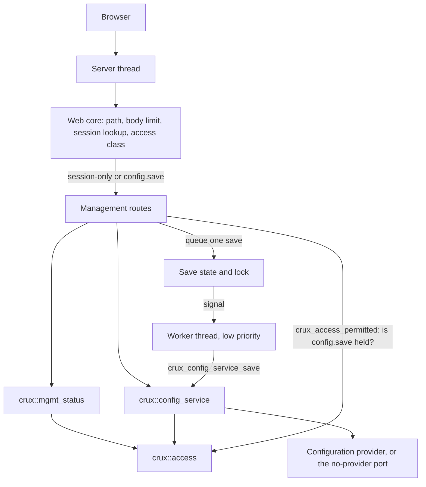
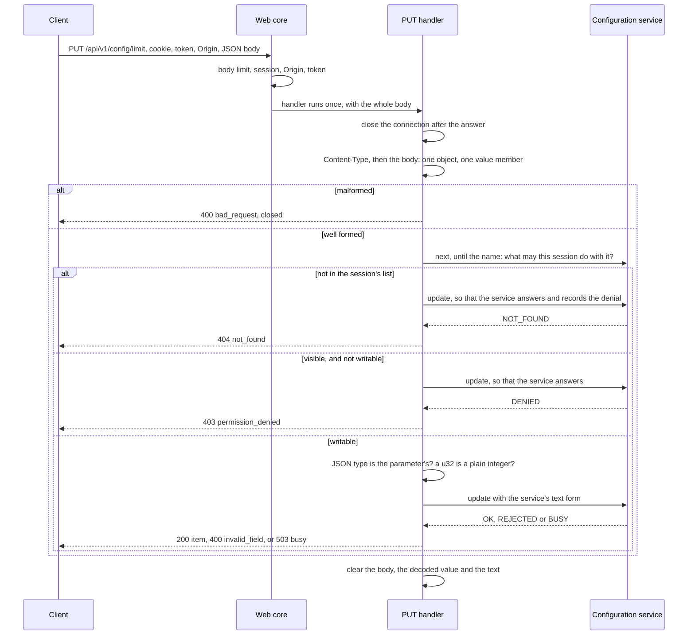
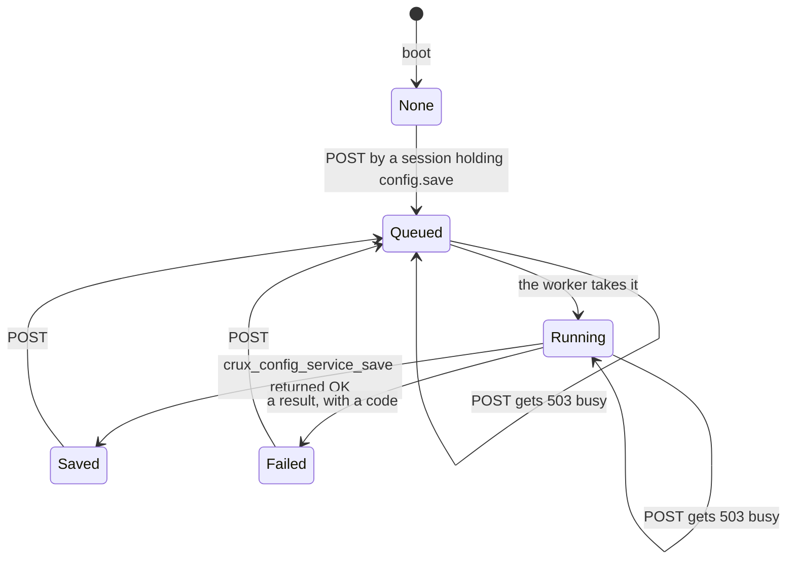

# Status, configuration and account web APIs

Status: merged in [PR #281](https://github.com/wonny-labs/crux-pilot/pull/281) for Issue #187. Nothing here has run on a board. #187's own suites are Host only, and
[the services image](native-composition-242.md) of #242 serves these routes over HTTPS on `native_sim`. Host and `native_sim` results are interim results, and physical evidence stays
tracked apart.

Owner: `components/web`. Internal header `components/web/management/crux_web_management.h`, for a composition only, like
`crux_web_session.h`. Sources in `components/web/management/`, listed by `sources.cmake`. The routes are described in
[`web/api/openapi.yaml`](../web/api/openapi.yaml), whose change rule applies: this is the one reviewed change that the firmware and
frontend tracks rebase onto.

## What is built, faked and untested

| Part | State | Evidence |
| --- | --- | --- |
| `GET /api/v1/status` over `crux_mgmt_status_report_json` | **Built** | Host, on the real Web, session, status and Access cores, with fake status sources |
| `GET /api/v1/config`, `GET` and `PUT /api/v1/config/{name}` over the configuration service | **Built** | Host, on the real service and the real Access core, with the fake Configuration store |
| `POST /api/v1/config/save` and its worker | **Built** | Host, with the worker step and with the real worker thread |
| Account routes: the current user and one's own password change | **Existing from #186.** The four cases are repeated here through the same image. | Host |
| Account administration routes (`/api/v1/accounts`) | **Not built.** [Decision 1](#decisions-taken-without-an-answer). | |
| Configuration routes in `openapi.yaml`, with named examples | **Built** | Specification lint, mock conformance |
| The mock server's configuration routes | **Built**, in the same change as the specification | Node unit tests, every answer checked against the specification |
| The routes' real answers against the specification | **Built.** `Web.management_openapi` holds 57 real answers to the merged schemas and statuses. | Host, standard library only |
| Fuzz of the reader, the routes and oversized input | **Built**, deterministic with fixed seeds | Host, and `host-sanitize` in CI |
| A composition that serves these routes | **Not in #187.** [The services image](native-composition-242.md) of #242 does, over HTTPS. | `native_sim` |
| `native_sim` | **Not run by #187.** Run later in [the services image](native-composition-242.md), and in the browser cases of [#220](e2e-native-220.md). | `native_sim` |
| RT1060 compile of the new sources | **Not run.** | |
| Anything on a board | Not run. No hardware was operated. | |

## Routes

All of them are JSON, with the security headers of the core, no CORS header and `Cache-Control: no-store`.

| Route | Access class | Calls | Success | Refusals |
| --- | --- | --- | --- | --- |
| `GET /api/v1/status` | session | `crux_mgmt_status_report_json` | `200` `{"items":[...]}`, the items this session may see | `401`, `503` |
| `GET /api/v1/config` | session | `crux_config_service_next` | `200` `{"items":[...],"save":{...}}`, with no value | `401`, `503` |
| `GET /api/v1/config/{name}` | session | `crux_config_service_read` | `200` `{"name","type","value"}` | `401`, `403`, `404`, `503` |
| `PUT /api/v1/config/{name}` | session | `crux_config_service_update` | `200` the item, with no value | `400`, `401`, `403`, `404`, `413`, `503` |
| `POST /api/v1/config/save` | `config.save` | `web_mgmt_save_queue`, then `crux_config_service_save` on the worker | `202` `{"state":"pending"}` | `401`, `403`, `413`, `503` |
| `GET /api/v1/session/me`, `POST /api/v1/session/me/password` | session | #186 | #186 | #186 |

Every operation can also get the server's own `409`, which holds no body and which no code here produces. A method that a path does not
have gets the server's plain `405`, and `/api/v1/config/save` is a fixed route with `POST` only, so a `GET` or `PUT` of it gets that
`405` and a parameter cannot be named `save`.

## One update, from the request to the answer

The order is a rule, and tests hold it: the body, then what the session may see, then what it may write, then the type, then the
service. A body therefore never decides whether a parameter exists, and a well-formed body gets `404` or `403` whatever it holds.

## The save

`crux_config_service_save` holds the service lock across storage and waits up to `CRUX_CONFIG_SERVICE_SAVE_WAIT_MS` (5 s) for it, so
it never runs on the server thread. The route queues it. The lock in `web_management_save.c` guards only the state, and nothing holds
it across the save, so the server thread waits at most 20 ms for it.

| State | What the list shows a session holding `config.save` |
| --- | --- |
| None | No `save` member |
| Queued, Running | `"save":{"state":"pending"}` |
| Saved | `"save":{"state":"saved"}` |
| Failed | `"save":{"state":"failed","code":"<code>"}` |

A session that does not hold `config.save` never sees `save`, and one that holds it and lists nothing sees `{"items":[],"save":{...}}`.
The check is `crux_access_permitted`, which leaves no event and does not refresh the idle timer.

| Service result | `code` | Meaning |
| --- | --- | --- |
| `ERR_STORE`, with `CRUX_CONFIG_ERR_NOT_SUPPORTED` | `not_supported` | No Configuration provider. Retrying will not help. |
| `ERR_STORE`, anything else | `storage_failed` | A save failed, and earlier ones stay saved. The marks stay on. |
| `ERR_BUSY` | `busy` | Another save, such as the application's own, held the service for the whole wait. |
| `ERR_SESSION_INVALID` | `unauthorized` | The session ended before the worker ran. |
| `ERR_DENIED` | `permission_denied` | Its permission was withdrawn meanwhile. |
| Anything else, `ERR_NOT_READY` included | `not_ready` | The service could not run it. |

The code names no parameter. A save also writes parameters that the session cannot see, and the service withholds their names from the
session, so a failure there is reported as a failure and nothing more.

While a save runs, every other configuration route that reaches the service answers `503 busy`, because the service lock is held and
they poll it. The list is one of them, so a client that polls for the end of a save sees `busy` and not `pending` while the worker is
inside storage.

## What the service's results mean on the wire

| Service result | Status and code | Where |
| --- | --- | --- |
| `ERR_SESSION_INVALID` | `401` `unauthorized` | Every route |
| `ERR_DENIED` | `403` `permission_denied` | Read of a parameter that is write-only to the session, and update of one that is not writable to it |
| `ERR_WRITE_ONLY` | `403` `permission_denied` | Read of a sensitive parameter, for whoever sees it |
| `ERR_NOT_FOUND` | `404` `not_found` | A name that is missing and one that the session cannot see, which look the same |
| `ERR_BUSY` | `503` `busy`, with `Retry-After` | Every route that polls the lock |
| `ERR_NOT_READY` and the rest | `503` `not_ready`, with `Retry-After` | Every route |
| `ERR_REJECTED` | `400` `invalid_field`, field `value`, `rule_not_met` | Update. A validator, the character rule or the capacity, with no reason. |
| `ERR_INVALID_ARGUMENT` | `400` `invalid_field`, field `value`, `wrong_type` | Update. Text that does not parse as the type, which the type check should make unreachable. |

| Status result | Status and code |
| --- | --- |
| `CRUX_OK` | `200` |
| `CRUX_ERR_INVALID_STATE` | `401` `unauthorized` |
| `CRUX_ERR_NOT_READY` | `503` `not_ready` |
| `CRUX_ERR_NO_RESOURCES`, and a document that does not fit the response | `503` `not_ready`. The composition's items do not fit one document. |

No error form holds a path, a parameter's value or native error text. `Retry-After` is the core's `1` on every `503` it builds.

## Request rules of the update

| Rule | How it holds | Shown by |
| --- | --- | --- |
| The body is one object with one member `value`, and nothing else | A bounded reader: no other member, no repeated member, no `null`, array or object, no text after the object | `fuzz.c`, 74 refused forms and 23 accepted, and `config.c` |
| `Content-Type` is `application/json`, in any case, with parameters allowed | Checked before the body is read. Anything else is `400 bad_request`. | `config.c` |
| The JSON type is the parameter's | A boolean for a bool, an integer for a u32, a string for a string. The service parses text, so it would take `"5"` for a u32, and this check is the one rule that the service does not hold. `400` `wrong_type`. | `config.c`, mutation below |
| A u32 is a plain integer from 0 to 4294967295 | Digits only: a sign, fraction, exponent or more than 32 bits is `400` `out_of_range` | `config.c`, `fuzz.c` |
| A string over the maximum, a validator, the character rule and the capacity | `400` `rule_not_met`. A string that does not fit the handler's buffer is refused without calling the service. | `config.c` |
| The connection closes after every answer | Any parameter may be sensitive, and a refusal must not show which. The server then clears its copy of the request. | `config.c` |
| The handler's static buffers hold no value afterwards | The body, the decoded string and the text of a bool or u32 are static and cleared on every path | `config.c`, with a marker for a string and for a u32, and a mutation that removes the clearing of the scalar text |
| **Not cleared:** the stack | The reader's result (`web_value_t`, holding a bool or a u32) and the call's arguments are on the stack and are not wiped, so a sensitive bool or u32 stays on the stack until it is overwritten. The service clears its update candidate and parse buffer, and does not clear the Configuration mechanism's own locals or the provider's buffer, as its limits state. No test can see a stack. | Nothing, stated here |
| A request that never reached the service leaves no event | The type, range and body checks answer first | `config.c` |
| A hidden or missing name reaches the service, which records a denial for a hidden one and nothing for a missing one | `update` is called with the request's text, so the service decides | `config.c`, mutation below |

## Bounds

| Bound | Value | Why |
| --- | --- | --- |
| `PUT` body | `CRUX_WEB_BODY_BUFFER`, 1 KiB. A larger `Content-Length` gets `413` before any session lookup. | The core's. A 128-byte string of quotes is 256 bytes escaped. |
| `POST /api/v1/config/save` body | 0. Any body gets `413`. | The route takes none |
| Response document | `CRUX_WEB_MANAGEMENT_BODY_MAX`, 4,096 bytes, the same as the core's `CRUX_WEB_RESPONSE_MAX` | One document in one buffer. A composition that raises one raises both. |
| A configuration list | At most 27 parameters of 30-character names, 31 of 12 characters, or 32 of 8 or fewer, at the default | Each item is 117 bytes and its name. `ConfigList` does not fit the buffer past that, and answers `503` `not_ready`. `config.c` shows the edge for the longest names. |
| A status report | The built-in items and up to 32 project items of the longest text overflow it | Measured on the fixture: 32 items of 63 bytes. A report that does not fit answers `503` `not_ready`. |
| A parameter's name | 30 characters. A longer path parameter cannot be a key and gets `404`. | The Configuration key limit |
| Lock wait on the server thread | 20 ms for the save state. The services poll and wait for nothing. | A held lock is `503 busy` |
| Static RAM of the routes | 4 KiB response, 1 KiB request body, 129 bytes of value text, and a few words of save state | Server thread only |

The handlers run on the server thread and stall every other client while they run. A status poll and a list are bounded by the table and
by the services' polls. A validator runs inside `update`, so a parameter that a table exposes needs a quick one, which the service
already requires of every validator. The save is the one slow operation, and it runs on the worker. The worker is at the `crux_thread`
`LOW` priority, so the stall that [the session worker](web-session.md#the-stall-that-work-on-the-worker-causes) declares applies to it
too: on a target it can preempt the server thread for the whole of a save. Neither the save's time nor the worker's stack was measured.

## Tests

| Command | Level | Covers |
| --- | --- | --- |
| `scripts/test-web.sh host` | Host, CI | All `Web.*` suites under debug and sanitizers, clang-tidy, the boundary and review checks |
| `ctest -R '^Web\.management'` | Host | The six suites below |
| `npm run check` in `web` | Node.js | Specification types, mock behaviour and conformance, including the configuration routes |
| `scripts/check-management-api.sh` | Node.js | The specification lint |

Every route has the four cases that the issue asks for.

| Route | Success | Unauthenticated | Unpermitted | Invalid input |
| --- | --- | --- | --- | --- |
| `GET /api/v1/status` | `status.c` success, each session's items | no cookie, forged cookie | an empty list for a session with nothing to see, never `403` | other methods, a path under it, a body on a `GET`, a failed source, a service not ready, a report that does not fit |
| `GET /api/v1/config` | `config.c`, for read-write, read-only and write-only sessions | `401` | an empty list, for a forced change too | other methods, a service not ready, a list that does not fit, a held lock |
| `GET /api/v1/config/{name}` | each type, with escapes | `401` | write-only and sensitive `403`, hidden `404` | names too long, dot segments, percent encoding, `save`, deeper paths, a body |
| `PUT /api/v1/config/{name}` | each type, a sensitive value, escapes | `401`, no token, no `Origin` | read-only `403`, hidden `404`, whatever a well-formed body holds | wrong type, out of range, rule, 48 malformed bodies, content types, oversize, names |
| `POST /api/v1/config/save` | `save.c` success, nothing to save, the real thread | `401`, no token, no `Origin` | six accounts without `config.save` `403` | a body `413`, other methods, a second save `503` |
| `GET /api/v1/session/me`, `POST .../me/password` | `account.c` | `401` | a forced change is allowed | malformed, wrong type, oversize, wrong content type |

| Suite | Cases | Also covers |
| --- | --- | --- |
| `Web.management_status` | 9 | Items by permission, a failed source, errors with no path |
| `Web.management_config` | 39 | The list of up to 32 long names, events, a held lock from another thread, and the connection closing |
| `Web.management_save` | 19 | One save at a time, the state shown only with `config.save`, every code, a session that ended, the application's save holding the service |
| `Web.management_account` | 9 | The routes of #186 |
| `Web.management_fuzz` | 9 | The reader against 74 refused forms, 40,000 random bodies and 34,500 mutations; 4,000 mutated updates and 6,000 random names through the routes; every body size from the limit up |
| `Web.management_openapi` | 1 | 57 real answers against the merged specification, with 23 negative controls |

The fuzz is deterministic: each stream has a fixed seed, so a failure repeats. For every input it checks what must hold whether the
body is accepted or not: the text buffer is a string, an accepted body that ends in `}` loses it when cut, an accepted u32 survives
a round trip, and through a route no input changes a value or a mark without a `200`, reaches a `5xx` or an error form that the
specification does not hold. It found one defect in the first version of the reader, which left an unterminated text after a body
refused part way through a string. The reader now terminates after every byte.

| Mutation, each tried once | Caught by |
| --- | --- |
| A string is accepted for a u32 or a bool | 2 cases in `config.c` |
| The connection is not closed after an update | 5 in `config.c`, 1 in `fuzz.c` |
| An update leaves its value in the handler's buffers | 1 in `config.c` |
| The save state is shown to every session | 1 in `save.c` |
| The save route needs only a session | The build, which fails on a session-only route that is not on the reviewed list |
| A read-only parameter is judged on its body | 1 in `config.c` |
| A read of a write-only parameter answers `404` | 3 in `config.c` |
| No `out_of_range` check | 1 in `config.c` and 1 in `save.c` |
| `busy` is answered as `not_ready` | 1 in `config.c` |
| Text after the object is accepted | 1 in `config.c`, 2 in `fuzz.c` |
| Any content type is accepted | 1 in `config.c` |
| A second save is queued over the first | 2 in `save.c` |
| A failed save loses its code | 6 in `save.c` |
| A failed save reads as saved | 6 in `save.c` |
| A hidden update never reaches the service | 1 in `config.c`, the denial check that was added after the mutation first passed |
| No check for a string over the buffer | 1 in `config.c`. The text then reaches the service, which refuses it and records a rejection, so the test asks for none. |
| The text of a bool or a u32 is not cleared | 1 case in `config.c`, `put: no scalar text left`, which has three checks of the buffer |
| The list asks `crux_access_check` for `config.save` in place of `crux_access_permitted` | 1 in `config.c`, the denial check. The idle check is made too, and this mutation does not change it. |
| The worker is never signalled (`crux_semaphore_give` removed) | **Not caught.** The worker wakes by its own 1 s timeout, inside the test's 5 s wait. A wake-up time is not tested. |
| A lock that does not come in time reads as not pending (`web_mgmt_save_view`) | **Not caught.** A lock held for that long cannot be made in a Host test. |
| A leading zero is accepted by the number reader | **Not caught.** The next token is a digit and the object is refused anyway. |
| A name too long is searched for | **Not caught.** An empty name is not found either. |

## Results

Local runs in container `crux-187`, image `crux-pilot-devcontainer:local` under amd64 emulation. CI results are in the pull request.

| Check | Level | Result |
| --- | --- | --- |
| `Web.*`, 13 suites: the three of #184, the four of #186 and the six of this change, debug preset, clang 18 | Host | Pass |
| The same management and session suites on GCC 13 with `-fsanitize=address,undefined` | Host, sanitizer | Pass, with `-fsanitize=address,undefined -fno-omit-frame-pointer -Wno-format-truncation`. GCC 13 needs the last flag: `-Werror=format-truncation` fails `config.c` and #186's `sessions.c` otherwise. This container's clang has no ASan runtime, so `host-sanitize` was **not** run locally, and CI's host workflow runs it. |
| First run of the management suites with every route answering `503 not_ready` | Host, red | status 6 of 9 cases failed, config 24 of 36, save 16 of 19, fuzz 3 of 9. `Web.management_account` passed, because it tests routes that #186 already built. The routes source existed in the worktree before the first run, and was swapped for that placeholder to record the red. |
| clang-tidy 18 on the management sources and suites | Host | No finding |
| `scripts/check-format.sh` (clang-format 18), `check-web-routes.py`, `check-web-boundary.py`, `check-mgmt-services-boundary.py`, the generator's tests | Host | Pass |
| `scripts/check-management-api.sh` (Spectral 6.16.3, Node.js 24.22.2) and `python3 -m unittest discover -s tests/management_api` | Node.js | Pass |
| `npm run check:types`, `typecheck` and the unit tests in `web` | Node.js | 521 of 523 pass. The 2 failures, in `tools/test/boundary.test.ts`, were on `main` before #187, and [#282](https://github.com/wonny-labs/crux-pilot/pull/282) has since fixed the boundary rule: [decision 17](#decisions-taken-without-an-answer). |
| 20 mutations of the routes, the reader and the save | Host | 18 caught, 2 equivalent, [above](#tests). Review found 2 more that are not caught, listed there. |
| `native_sim`, RT1060 compile, `host-sanitize` with clang | | **Not run** |

## Limits of the design

- The save state is global. Any session holding `config.save` sees the outcome of another user's save, and only a failure code, never a name.
- The worker has no stop or join. `crux_web_management_init()` resets the state and is safe only before the worker starts, which a composition does once at boot.
- The mock follows the device where a client could see a difference: a repeated member and a content type that is not JSON are `400`, and a malformed body is `400` before the parameter is looked at. It still differs in three ways: its body limit is 4,096 bytes and not 1,024, it ignores the query as the device does but never answers the server's plain `500`, and its number rule reads the lexeme of the one `value` member by pattern.
- Two more differences, which were already there and which no client of a browser sends. An escaped member name such as `{"v\u0061lue":8}` is accepted by the device, and the mock's pattern for a plain integer names the literal `value`, so the mock refuses a u32 sent that way as `out_of_range`. A lone surrogate escape in a string value, such as `"\ud800"`, is `400` on the device and `200` in the mock, which holds it as a string.

## What is not verified

- A board. `native_sim` and TLS ran after #187, in [the services image](native-composition-242.md); the cases of #187 itself are Host only.
- The routes on a target: the save's time, the worker's stack, the stall it causes on the server thread, and the time of a status
  poll or a list on the server thread.
- Concurrent clients. The Host suites drive one request at a time through the fake transport. A real worker thread runs in one case.
- Safari, and whatever #186 left open.
- The Wolf profile, and RT1060 compile of the new sources.
- A frontend against the routes. #243 adds the Angular scenarios, and the mock now serves the same routes.
- The `validators run quickly` assumption, which nothing enforces.

## Decisions taken without an answer

| # | Decision | Narrower choice | Alternative |
| --- | --- | --- | --- |
| 1 | No account administration routes. The accounts API is the current user and one's own password change, which #186 built. | The specification, the web design's outline and the frontend design promise `/api/v1/accounts` only as an outline, the issue asks the specification for configuration routes alone, and creating accounts and resetting passwords over HTTP is a security-sensitive public contract. It needs its own design. | Add list, create, role, disable and reset to the specification and the routes in this change |
| 2 | `POST /api/v1/config/save` has the access class `config.save`, not session-only | The core enforces it before the handler and records the denial, and the service checks it again on the worker. The review list shrinks by one. | Session-only, with the handler checking, as the web design's outline says |
| 3 | The save is asynchronous. Its outcome is the `save` member of `GET /api/v1/config`, for a session holding `config.save` | A save holds the service lock across storage, so it cannot run on the server thread. A new route would add a contract, and a member of an existing response does not. | `GET /api/v1/config/save`, which the contract already reserves for `405`, or a poll by attempt identifier |
| 4 | The list is one response in a 4 KiB buffer: at most 27 long names or 31 of 12 characters | The core answers one buffer, and streaming is a change to the core's contract | Omit flags that are false, which halves the size and makes every flag optional. Page the list. Raise both buffers in a composition. |
| 5 | The list and the update's response hold no value. A client reads with `GET`. | The service's own rule for a response after an update, and nothing sensitive ever leaves | Return the value for a non-sensitive parameter |
| 6 | The JSON type must be the parameter's, and a number is a plain u32 | `"5"` for a u32 would otherwise pass, since the service parses text. New field codes `wrong_type` and `out_of_range`, and `rule_not_met` reused. | Accept text for a scalar |
| 7 | A sensitive parameter's read is `403`, not `404` | A session that sees it knows from `readable` and `sensitive` already, and a session that cannot see it gets `404` | `404` for both |
| 8 | An update closes the connection after every answer | Any parameter may be sensitive, and a refusal must not show which | Close only after a sensitive parameter, and so show which |
| 9 | A malformed body is `400` before anything is known of the name | A body never decides whether a parameter exists, in either direction | Look the name up first |
| 10 | A report or a list that does not fit one response is `503` `not_ready` | No code says "too large to serve", and a new code is a change to the specification | A new code |
| 11 | A reader of its own, in `web_management_json.c` | #186's files stay unchanged, and its reader takes strings only. About 100 lines of escape decoding are duplicated. | Generalise the session reader |
| 12 | The query string is ignored | Nothing here reads one | Refuse a query |
| 13 | `GET /api/v1/config/save` and `PUT` get the server's plain `405`, so no parameter is named `save` | The contract (#184) declares it, and the specification says so | A path other than `save` |
| 14 | The mock reuses `networkProvider` for a save, and `savePolls` counts reads of the configuration list as well as of the network state | One switch for "no Configuration provider", as on a device | A second setting |
| 15 | `scripts/test-web.sh` is edited to build and tidy the new suites | A protected path, edited only to add targets and sources, as the test runner of a component that this change adds. No suite, board, option or warning flag is removed. | Leave CI to the full host preset alone |
| 16 | `tests/web/session/session_test.c` gains `session_test_setup_web`, the web half of its setup | The management suites boot Access with their own accounts. Its other behaviour is unchanged. | Copy the fixture |
| 17 | `web/tools/test/boundary.test.ts` failed two tests on `main`, and was left alone in #187. **Fixed by #282.** | They fail before this change: `cmake/CruxWebRoutes.cmake`, `tests/mgmt_status/CMakeLists.txt` and four sources in `components/` already name `web/api`. New files avoid the pattern. | Fix the earlier files in this change |

## What the composition and #243 need

| Item | Where |
| --- | --- |
| Compile `CRUX_WEB_MANAGEMENT_SOURCES`, name `CRUX_WEB_MANAGEMENT_ROUTES` to `crux_web_routes(... SOURCES ...)`, and give `REVIEWED` the lines of `components/web/reviewed-routes.txt` | `components/web/management/sources.cmake` |
| Start the status and configuration services before the server, then `crux_web_management_init()`, then `crux_web_management_start_worker()` | `crux_web_management.h` |
| Link `crux::config_service`, `crux::mgmt_status`, `crux::sync` and `crux::thread` | The composition |
| A `config.save` permission in the roles that may save, and the table's permissions in the roles that may see each parameter | The product's policy |
| Keep validators quick | The service's contract |
| Raise `CRUX_WEB_RESPONSE_MAX` and `CRUX_WEB_MANAGEMENT_BODY_MAX` together for a larger table | The composition |
| The frontend's scenarios use the mock's routes: `listConfig`, `getConfigItem`, `putConfigItem` and `saveConfig` | `web/client/src/api-types.generated.ts` |
