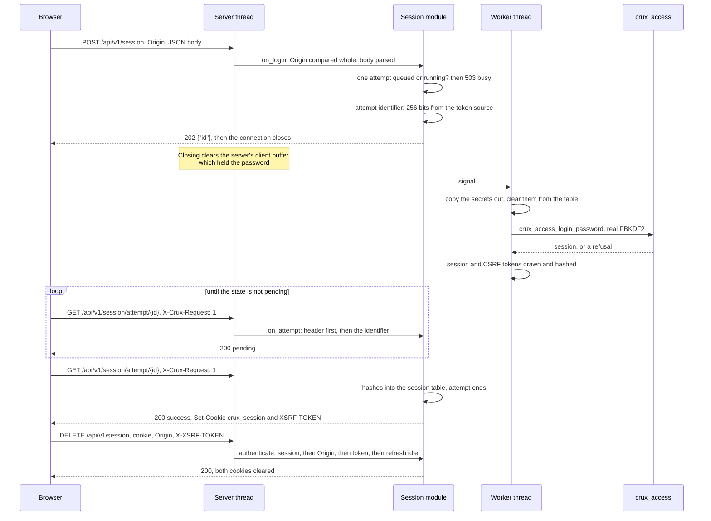
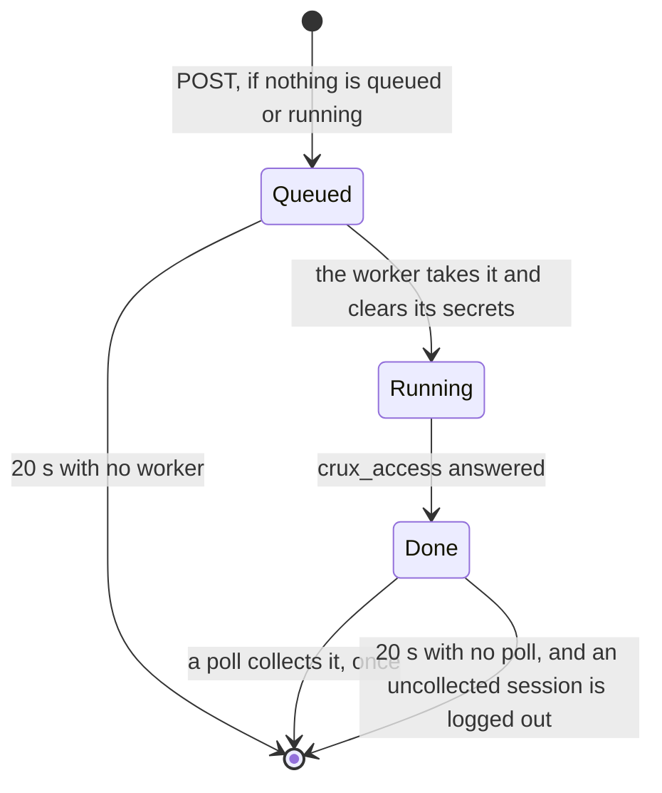

# Web login, sessions and request forgery protection

Status: implementation for review under Issue #186. Nothing here has run on a board, and nothing here uses TLS, which
is #185. Host and `native_sim` results are interim results, and physical evidence stays tracked apart.

Owner: `components/web`. Internal header `components/web/session/crux_web_session.h`, for a composition only, like
`crux_web_adapter.h`. Sources in `components/web/session/`, listed by `sources.cmake`. Ports on PSA Crypto in
`components/web/ports/psa/web_session_psa.c`.

## What is built, faked and untested

| Part | State | Evidence |
| --- | --- | --- |
| `crux_web_authenticate_t` over `crux_access`: cookie, session table, `Origin`, CSRF token, idle refresh | **Built** | Host on the real Web and Access cores. `native_sim` on the real Access core and its real PSA ports. |
| Two-request login through one bounded worker (decision D10) | **Built** | Host, with a real worker thread. `native_sim`, with real PBKDF2. |
| Session routes: login, attempt poll, logout, current user, own password change | **Built** | Host and `native_sim` |
| Random and hash ports on PSA Crypto | **Built** | `native_sim` on TF-PSA-Crypto. RT1060: compile only, in CI. |
| Entropy on `native_sim` | **Test-only**, `fake_entropy_native_sim`. **A token's strength is not shown anywhere here.** | |
| Fake random and hash ports | **Faked on Host only**, in `tests/web/session/session_test.c`: distinct bytes and an FNV hash, neither cryptographic | |
| Fake transport | Host only, from `tests/web` | |
| Idle and absolute expiry | Host only. The limits are 15 minutes and 8 hours in the composition, too long for a `native_sim` run. | |
| HTTPS | **Not here.** Plain HTTP on loopback, in a `native_sim` test image only. #185. | |
| Header capture on Safari | **Not run.** Safari cannot run unattended on this machine. The criterion stays open. | |
| RT1060 | Compile only, not linked: an image also needs the Access core and its store | |
| Anything on a board | Not run. No hardware was operated. | |

## How a login flows

## Rules

| Rule | How it holds | Shown by |
| --- | --- | --- |
| The server thread never verifies a password | Login and a password change only queue. The worker runs `crux_access`, outside every lock. | `concurrency.c`: a verification held open for 10 s while 250 other requests are answered in at most 1 ms a round |
| One verification at a time | One attempt queued or running. Another `POST` gets `503 busy` with `Retry-After`. | `login.c` busy case |
| Attempt identifiers of at least 128 bits, from the session token source | 256 bits, one draw from `crux_web_session_port_random`, the same function that draws session and CSRF tokens | `login.c` compares the identifier and the CSRF token with the port's last draw |
| The poll requires `X-Crux-Request: 1` | Checked before the identifier is read. Without it: `403 csrf_rejected`, no cookie, attempt unchanged. | `login.c` and `native_sim`, before and after the worker finishes |
| Session token stored as a hash | SHA-256 of the 43-character token. The CSRF token is stored as a hash too. Every slot is compared, so time does not say which matched. | Host |
| Cookies | `crux_session=<token>; Secure; HttpOnly; SameSite=Strict; Path=/` and `XSRF-TOKEN=<token>; Secure; SameSite=Strict; Path=/`, with no persistent expiry | Byte for byte, Host and `native_sim` |
| CSRF token holds no `%` and no quotes | Unpadded base64url, `A-Z a-z 0-9 - _` | Host and `native_sim` |
| CSRF token independent of the session token | A separate draw | Host and `native_sim` |
| State-changing requests need the token and `Origin` | Any method but `GET`. Session first, so no session is `401`. Then `Origin`, then the token. | `sessions.c` on `POST`, `PUT`, `DELETE`, `PATCH`, and `native_sim` |
| `Origin` on login | Checked before the body is read, and before anything is drawn or queued | `login.c` with 15 wrong forms, and `native_sim` |
| Accepted `Origin` | The scheme, `://` and the request's own `Host`, compared whole and exactly, with `Host` limited to name and address characters. A composition may give an exact list instead. | `sessions.c` |
| Idle and absolute expiry | `crux_access` holds both limits. State-changing requests call `crux_access_touch`, and `GET` does not. | `sessions.c` on the fake clock |
| A password or role change ends sessions | `crux_access` ends the account's sessions. The next lookup finds the session invalid, clears its slot and answers `401`. A disable and an administrator's reset do the same. | `sessions.c`, and `native_sim` for one's own change |
| Replies do not reveal whether a user exists | Every login is queued and answers `202`. Every rejection polls as `{"state":"rejected"}` with the same headers: wrong password, unknown name, disabled account, a name outside the rules, a name holding a NUL, a password over 128 bytes, and an unusable store | `login.c` and `native_sim`, byte for byte |
| Security headers | The core's: CSP, `nosniff`, `no-referrer`, `no-store`. **No HSTS**, and no CORS header. | `sessions.c` on every session route, and `native_sim` |

## What a lookup receives, from the review of #184

| Property | Rule here |
| --- | --- |
| A NUL in a header value ends the captured value | Every check compares a whole expected value with the whole captured one, by length and content: the cookie's token, the CSRF token, `Origin` and `X-Crux-Request`. A captured prefix of a token never passes. On `native_sim` a token cut by a NUL got `403`. |
| An empty duplicate header evades the duplicate check | An empty value reads as no header, and every check needs a value. An empty duplicate beside the right value changes nothing, and alone it is refused. Both shown on `native_sim`. |
| A NUL after a correct value | `X-Crux-Request: 1` followed by a NUL and more is captured as `1` and passes. Only a client that is not a browser can send it, and such a client can send `1` anyway, so it gains nothing. |
| The password stays in the server's `client->buffer` | **Login and a password change close the connection after every response**, including refusals. Zephyr's `http_server_release_client` then clears the whole client context, with its buffer and capture, at v4.4.2. The core clears its body copy, the handlers clear their buffers, the worker clears the attempt's copy when it takes it and its own copy after verifying. Host tests check that the marker password is in none of these. |
| What stays in RAM | Copies outside Crux: the host or Zephyr TCP buffers, and with #185 the TLS record buffers. A session token also passes through every request's capture buffer and the shared response store, until each is overwritten. The table holds hashes only. |

## Bounds

| Macro | Default | Why |
| --- | --- | --- |
| `CRUX_WEB_SESSION_MAX` | 8 | No more can be live than `crux_access` holds. An ended session's slot is reused. A full table answers the poll `503 busy` and logs the new session out. |
| `CRUX_WEB_SESSION_ATTEMPTS` | 4 | One queued or running, the rest waiting for their poll. A full table refuses with `503` rather than drop a result. |
| `CRUX_WEB_SESSION_ATTEMPT_TTL_MS` | 20,000 | "Attempts expire quickly" |
| `CRUX_WEB_SESSION_LOCK_WAIT_MS` | 20 | The server thread's longest wait for the attempt lock. The worker holds it only to copy. |
| Login and password change body | `CRUX_WEB_BODY_BUFFER`, 1 KiB | A 128-byte password of control characters is 768 bytes once escaped |

RAM: the attempt table is about 2.3 KiB and the session table about 0.6 KiB at the defaults, and the handlers keep 1.3 KiB
of static buffers for the server thread. The worker uses the `crux_thread` default stack, 8 KiB in the composition, which
was not measured: `native_sim` threads run on host stacks.

## The stall that concurrent failed logins cause

The design moved verification to a worker so that it would not stall the server thread. It still can, and this is the
declared limit.

| Platform | What happens during one verification | Source |
| --- | --- | --- |
| `native_sim` | A thread that computes is never preempted, so the server thread waits for the whole verification | Measured, below |
| A target, by the source, not run | The HTTP server thread runs at the lowest preemptive priority, `K_PRIO_PREEMPT(CONFIG_NUM_PREEMPT_PRIORITIES - 1)`, and `crux_thread` priorities map to 6, 5 and 4. So the worker, at `LOW`, preempts the server thread for the whole verification too. With `NET_TC_THREAD_COOPERATIVE` the server thread is cooperative and would preempt the worker instead. | Zephyr v4.4.2 `http_server_core.c`, `components/thread/ports/zephyr/thread_native.c` |

**Declared limit: another client waits at most one verification time, `T_v`, plus the requests ahead of it.** Only one
verification runs at a time, and after each the worker waits for the next `POST`, which the server thread must handle,
so the server thread runs between any two. Logins inside a `crux_access` delay window cost no verification. `T_v` on a
target is unmeasured, and `CRUX_ACCESS_VERIFIER_ITERATIONS` is still the 10,000 placeholder, so #197 should measure it
with the web stall in mind, or give `crux_thread` a priority below the server thread's.

| `native_sim` measurement, two clients sending failed logins for 60 rounds of another client's `GET /api/v1/session/me` | Result |
| --- | --- |
| The other client, before: median and largest wait | 9 ms and 17 ms |
| The other client, during: median and largest wait | 10 ms and 86 ms, every request answered `200` |
| Failed logins by the two clients | 6 verified and rejected, 20 refused as `429` inside the delay window, none busy |
| Longest whole failed attempt seen by a client, `POST` to result | 0.399 s |
| Bound checked | largest wait during at most largest before, plus the longest whole failed attempt seen by a client, plus 1.5 s for the emulated container |
| The worker's own counter, `worker_max_ms` | 0: the simulated clock does not count computing, as the composition records, so the bound uses the client's measure |

## Tests

| Command | Level | Covers |
| --- | --- | --- |
| `scripts/test-web-session.sh host` | Host | The four suites, `host-sanitize` when the toolchain has its runtime, clang-tidy, both review lists |
| `scripts/test-web.sh host` | Host, CI | The same suites, under debug and sanitizers, with the existing web checks |
| `scripts/test-web-session.sh native` | `native_sim`, CI in the PSA workflow | `tests/native/web_session`, Mbed profile, and `test_driver.py` as a real client |
| `scripts/test-web.sh target mbedtls` | RT1060 compile, CI in the PSA workflow | The session module and its PSA ports compile for the target, as five objects |

| Host suite | Covers |
| --- | --- |
| `login.c` | The two requests, cookie attributes, the token source, the poll header, unknown and malformed identifiers, identical rejections, the delay window as `429`, busy and full tables, expiry and the logout of an uncollected session, `Origin` on login, body rules, the password not staying, random failures, a full session table |
| `sessions.c` | Missing and forged sessions, including a prefix, a changed character, quotes, percent encoding, a near name and a duplicate; the forgery rules on every method; a configured `Origin` list; wrong role and a forced change; idle and absolute expiry; role change, reset and disable; one's own password change with each result; logout; security headers; a failing hash |
| `json.c` | The bounded reader: escapes, surrogate pairs, NUL, overflow, and 31 malformed bodies |
| `concurrency.c` | The real worker thread: a verification held open while other requests are answered, and 40 failed logins beside another client |

| `native_sim` case, on the real Access core, PBKDF2 and store | Result |
| --- | --- |
| Two-request login, cookies byte for byte, a result collected once, the current user | Pass |
| Poll without the header, or with `0`, `11`, `true`: `403`, no cookie, then collected | Pass |
| Missing, forged, prefix and swapped tokens: `401` | Pass |
| Wrong role: `403 permission_denied` | Pass |
| Missing and short CSRF token, missing, wrong and extended `Origin`, login with a wrong or no `Origin` | Pass |
| Empty duplicate headers, and a token cut by a NUL | Pass, as declared above |
| Own password change: queued and closed, success with no cookie, the other session ended | Pass |
| Logout clears both cookies and ends the session | Pass |
| Wrong password, unknown name and bad name give identical poll responses | Pass |
| Failed logins beside another client | Pass, within the bound |
| The random, hash, derive and login functions come from their real sources in the image | Checked with `nm -l` |

| Mutation, each tried once on Host | Caught by |
| --- | --- |
| The poll ignores `X-Crux-Request` | 37 checks in `login.c` |
| The poll checks the header only after collecting the attempt | 34 in `login.c` |
| The CSRF token is not compared | 17 in `sessions.c` |
| `Origin` is not checked on session routes | 33 in `sessions.c` |
| `Origin` matches by prefix | 8 in `login.c`, 9 in `sessions.c` |
| Login does not close the connection | 18 in `login.c` |
| `GET` refreshes the idle timer | 3 in `sessions.c` |
| A duplicate session cookie is accepted | 4 in `sessions.c` |
| A session `crux_access` ended stays in the table | 1 in `sessions.c` |
| The worker leaves the password in the attempt | 1 in `login.c` |
| A longer cookie value is accepted | **Not caught**, because the token's form check refuses it as well. Both checks stay. |

## Results

Local runs in container `crux-186`, image `crux-pilot-devcontainer:local` under amd64 emulation, Zephyr v4.4.2 with
TF-PSA-Crypto `dc575a2` and Mbed TLS `a3e190f`. CI results are in the pull request.

| Check | Level | Result |
| --- | --- | --- |
| `Web.*`, seven suites, three of them from #184, debug preset | Host | Pass |
| `host-sanitize` | Host | **Not run locally**: the container's clang has no ASan runtime. CI's host workflow runs it. |
| clang-tidy on the session and core sources and suites | Host | No finding |
| `scripts/check-format.sh`, `scripts/check-web-boundary.py`, the generator's tests, both review lists | Host | Pass |
| `scripts/test-web-session.sh native`, twice | `native_sim/native/64`, Mbed profile | Pass, every case. A login took 0.315 s from `POST` to success, and a password change 0.303 s, polling every 50 ms. |
| RT1060 compile | Target compile | **Not run locally**: this workspace has no NXP HAL. CI's PSA workflow runs `scripts/test-web.sh target mbedtls`. |

## What is not verified

- Safari. Header capture on Safari is still open, and is recorded as not run in `docs/web-contract.md`.
- HTTPS, and `Origin` and `Host` on a real address with HTTPS. #185.
- Token strength: the entropy on `native_sim` is test-only.
- Idle and absolute expiry on `native_sim`, and anything on Zephyr's own TCP stack.
- The worker's stack and the verifier's time on a target, and the stall they cause.
- The Wolf profile on `native_sim`. Only the Mbed profile runs.
- Security events for a refused CSRF token or `Origin`: none are emitted, because the event contract has no identifier for them.

## Decisions taken without an answer

| # | Decision | Narrower choice | Alternative |
| --- | --- | --- | --- |
| 1 | `POST /api/v1/session/me/password` is implemented here | It shares the worker, the attempt and the poll, which the specification defines in the session tag, so #187 need not reach into them | Leave it to #187 |
| 2 | One attempt queued or running at a time, and a full table refuses | No result a client is polling for is dropped | A queue, or evicting the oldest result |
| 3 | A `crux_session` cookie that appears twice is no session | A tossed cookie can deny, but cannot choose the session | Try each |
| 4 | `Origin` must be the scheme and the request's own `Host`, unless a list is given | No configuration needed for a device without a fixed name. A DNS rebinding page has matching `Origin` and `Host`, but the `SameSite=Strict` cookies of the device's name are not sent to it, and with #185 the certificate does not match. A product with a fixed name should give the list. | Require the list |
| 5 | Plain `http` is refused unless the build defines `CRUX_WEB_SESSION_PLAIN_HTTP_FOR_TESTS` | Only the `native_sim` test image defines it | A runtime setting only |
| 6 | Tokens and identifiers are 256 bits, hashed with unkeyed SHA-256 | A token of 256 bits needs no key | HMAC with a boot key |
| 7 | Login and a password change close the connection after every response | The server then clears its copy of the password. A poll costs a new connection, and with #185 a new handshake. | Keep the connection and declare the copy |
| 8 | A poll that cannot take the lock in 20 ms answers `pending` | Leaves the attempt as it was. `503` would tell the client that it ended. | `503` |
| 9 | Order of checks: session, then `Origin`, then token, then the idle refresh | `401` says nothing about a token. A denied permission after a valid token still refreshes the idle timer, since the user acted. | Refresh only after the access class |
| 10 | A success nobody collects is logged out after 20 s | An abandoned session does not wait for the idle limit | Leave it to the idle limit, as the specification allows |
| 11 | The request head gains the peer's address, IPv6 as its /64 prefix, and an unknown peer has none, which shares one delay bucket | `crux_access` needs a source for its delays | |
| 12 | `crux_web_close_after_response()` is added to the adapter header | Three lines in the core, and the adapter's existing close path | |
| 13 | The logout response is `200` with an empty `text/plain` body | The specification says not to parse it as JSON | `application/json` with no body |
| 14 | `Secure` is set in the plain HTTP test image too | The cookie lines are those of a product. Browsers treat `http://localhost` as secure. | Drop it in the test image |
| 15 | The `native_sim` image uses `CONFIG_MINIMAL_LIBC`, as `tests/native/web_http` does, for Zephyr's `fnmatch` | Upstream sources warn of implicit declarations under it, as in that image | Picolibc |
| 16 | RT1060: compiled as objects, not linked | A link needs the Access core's store and events, which only a product composition brings | Stub ports in a compile test |

## What #187 needs

| Item | Where |
| --- | --- |
| The session lookup for its routes | Compose `crux_web_session_authenticate` and name `web_session_routes.c` to `crux_web_routes`, as `tests/native/web_session` does |
| Session-only routes get `Origin`, the CSRF token and the idle refresh for free on any method but `GET` | `crux_web_session_authenticate` |
| A handler checks its own permissions with the session it is given | Unchanged from #184 |
| The account routes must not add a password change: it exists, at `POST /api/v1/session/me/password` | `web_session_routes.c` |
| An account change that ends sessions needs nothing more here: the next lookup answers `401` | `sessions.c` shows it |
| Slow work goes to a worker, and the web stall above applies to any worker at a `crux_thread` priority | This document |
